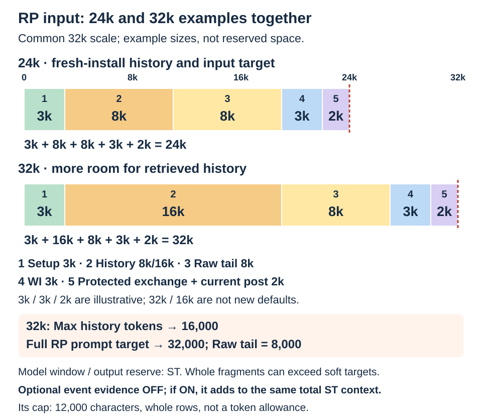
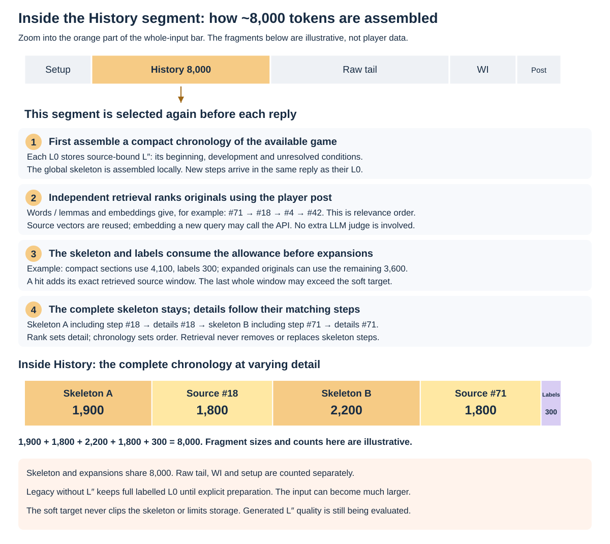
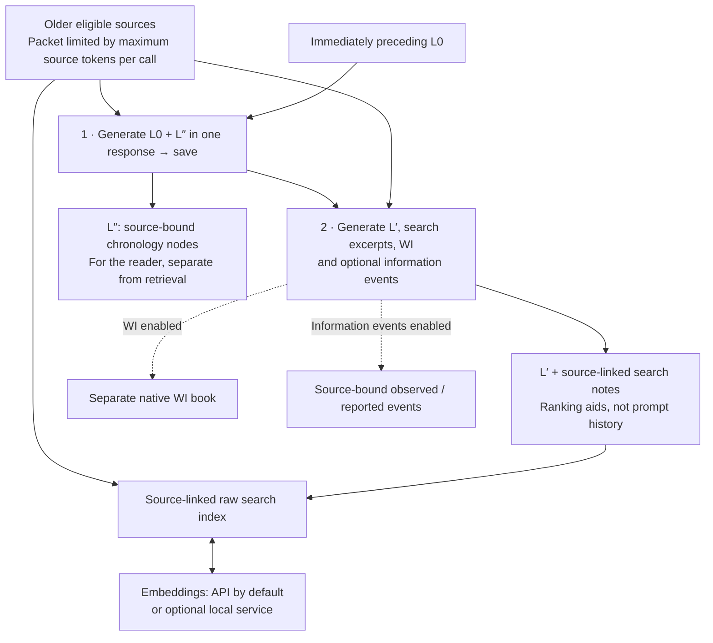
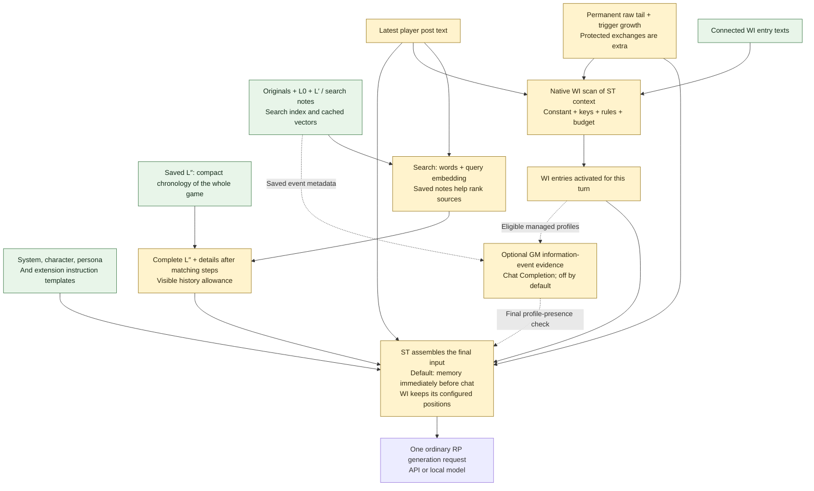

# WorldMemory for SillyTavern

**One game calendar:** the same L0 response records dated player locations and calendar transitions. The next L0 request receives the fixed per-chat epoch and accumulated date. A next-morning transition advances the calendar day without inventing an exact hour. `archive.snapshot().calendar` is the shared authority used by Atlas route and calendar dates; original relative wording remains evidence. Atlas offers a Legends calendar profile with familiar day/month aliases of the same game date and BBY/ABY year, not an Earth-date conversion. Unknown older intervals remain explicit; no extra calendar model calls run automatically to reconstruct them. Invalid location evidence is reported independently while valid elapsed time and supported visits remain usable; an unknown end hour preserves accumulated hours.

Missing calendar sidecars are automatically replayed from saved successful L0 responses when their complete prose exactly matches one current source-linked L0. This local step makes no model call and requires no old game import; edited or stale L0 is preserved. In Atlas, **Уточнить календарь моделью** explicitly makes one summarizer-connection request using the selected L0 and their complete original messages. It updates only derived dates and player locations, preserving chat, L0 prose, WI and the fixed epoch. Stop, changed history or an unusable response keeps the previous calendar; unsupported packet corrections retain their previous dates and locations.

**One-file game handoff:** **Экспорт всего** saves a complete private support bundle. **Импорт всего** creates a separate character, related lorebooks and complete chat/memory from that file. Copies share the next free suffix, such as `Import_(1)`; original games and API connection settings are preserved. Use this to exchange and improve complete game setups without replacing the installed original.

**ST crashes while loading a large game PNG?** See [startup recovery](tools/PNG_RECOVERY_RU.md). The standalone repair replaces the dependency's memory-heavy PNG text decoder; it keeps cards and chats unchanged. Updating a browser extension alone cannot repair a crash before the browser loads.

**Automatic search/WI recovery (0.5.34):** a new L0 or changed chat, book or connection starts one recovery queue when memory/RP generation is idle. It processes missing stage-2 metadata in chunks of up to four L0 blocks and continues while blocks are successfully prepared. A failure or unchanged partial result stops the same-input retry; a new L0 or changed connection permits another attempt. Stop and chat changes cancel active work. Pausing automatic summarization also pauses recovery. Existing usable or empty WI results are not regenerated automatically. Recovery makes stage-2 model calls; no separate recovery button is required. Local WI proposals can be reviewed with the next metadata call or through an explicit review.

**Claim-level WI review (0.5.37):** a review can accept supported claims individually and record reasons for rejected claims. Accepted changes are written without discarding the rest of the proposal. Existing and manually maintained entries remain protected.

**WI corrections (0.5.36):** a malformed change no longer blocks unrelated WI changes or later packets. Partial items remain visible; use the correction button for one model request, or apply its saved response without another request. Protected manual entries and source and branch checks remain in force.

**Saved DIFF journals:** existing confirmed evidence moves to local L0 contributions; the original journal and unresolved proposals remain retained. Use **Prepare search / WI** for the affected L0 when its model response is missing or needs correction. Fact-level review is separate from ordinary prompt retrieval: unreviewed proposals are not established WI. An explicit review costs one model call; replaying its saved response costs none. Changed originals can require re-extracting the affected block; local replay cannot invent a missing answer.

[Русский — полная инструкция](README_RU.md) · [Detailed reference](docs/REFERENCE.md) · [Changes](CHANGELOG.md)

> **Not cache-friendly:** WorldMemory rebuilds the retrieved history sent for inference on each turn. This can reduce reuse of your API provider's prompt/input-token cache, although unchanged parts of the request may still benefit from caching.

**Keep earlier story events within reach as your chat grows.** WorldMemory saves source-linked summaries of older messages, retrieves relevant history for the next reply, and maintains generated World Info references in the book explicitly selected for this chat.

**0.5.38 · standalone preview.** No Summaryception installation is needed. API embeddings are the default; a local model is optional.

**Local WI contributions:** chats with a saved DIFF journal move confirmed facts into the existing L0 contribution store when WI updates, without reimporting the game. Native UIDs, manual entries, retired evidence and the original journal are retained. New proposals receive fact-level review in the next metadata request or through **Проверить последнее предложение**. Replaying a saved response makes no model call. A failed block stays separate from later work. Missing historical dependencies remain unknown, and model review does not guarantee factual correctness.

Names containing an internal apostrophe, such as `Дари'Мар` and `Дари’Мар`, now remain one history-search term. Update **Russian WI Forms to 0.1.8** as well for whole-name forms and native WI activation, then reload SillyTavern. Existing saved keys and story text stay unchanged.

If a local tokenizer failure invalidates a saved calibration, optional history details pause instead of filling the next request in an uncalibrated scale. The complete outline, raw tail and manual settings remain intact. The next turn checks for recovery of the measured counter; a valid calibration made on a fallback counter keeps its measured scale. Calibration remains approximate and does not guarantee a provider input limit.
WorldAtlas0.4.2 portable route/calendar imports also seed the next L0 calendar context: the imported epoch, accumulated time and calendar unit profile are read without rewriting the archive or manual calendar settings. New local packets after the import boundary continue that clock; undoing/removing the Atlas import restores the prior calendar authority. A first local packet that crosses the import moment keeps new source-confirmed locations, while its inseparable elapsed time remains explicitly unknown.

New L0 summaries return source-linked dates, elapsed time and player locations in the same model response for WorldAtlas's calendar and route. Repeated full-game imports exclude ancestral lorebook copies from the current request. **Экспорт всего** now includes the last completed game request's exact native messages, model and separate local estimate; provider usage and request ID remain **unknown** unless ST exposes them. This diagnostic is kept only in the current page session and excludes connection keys/headers; server/provider transformations are outside its scope.

The main panel now shows history coverage per message range: L0, complete outline, search, prepared WI and its current book-write receipt are separate states. Tap a row for exact sources and actions. **Экспорт всего · один файл** downloads the current chat, card/cover, archive, related books, saved replies, available diagnostics and sanitized settings as one private support file. It makes no model request or WI write; unavailable sections are reported while the rest are preserved.

For Chat Completion, history first uses its configured allowance. After ST assembles the full request, a final local stage measures the remaining space and adds more already ranked history details towards the desired context. It preserves the complete outline, previous details, raw tail, WI and manual settings. Whole passages must fit the remaining space; an already overflowing request is kept whole. Protected exchanges remain outside the desired-context budget. This stage adds no model or embedding calls and does not yet apply to Text Completion. The UI shows the final request separately from the planning allocations.

**Optional provider-input calibration:** enter the unadjusted **WM proxy** and provider **prompt/input** counts from the same request under Context budget. The measured ratio applies only to that main connection, profile, model and local counting scale. It adjusts history selection, raw-context estimates and final top-up together; the complete outline and mandatory native raw tail remain intact. One sample is an approximation, not provider usage or a guaranteed input limit. Summary API batch limits and ST's native WI limits retain their own units. Apply/reset makes no model request; no connection or model is preconfigured.

Already activated character profiles mentioned in the latest exchange are placed before the latest player post. Activation still belongs to SillyTavern. This applies to managed character profiles, author entries explicitly tagged `extensions.worldMemory.type: "character"`, and profiles matching the configured character catalogue. Untyped author lore keeps its configured placement. A managed profile's `Played memory through source message …` line records its update boundary; it is not a separate instruction or search hint. Request placement does not rewrite saved book positions.

Identical character-profile copies in different attached books are inserted once. Different content, keys, conditions and manual metadata remain separate; sticky/cooldown entries retain native ST accounting. PNG restore reuses an identical linked book. Imports retain older books; generated updates modify the explicitly selected destination's managed records while preserving manual entries.

## Start with the recommended setup

1. Set **Desired context (tokens)** on the main panel, then use **Recommend values for this context · Подобрать значения**. Every suggested value remains editable. Updating the addon does not apply this button for you.
2. Configure **Summarizer connection** for background memory preparation. Your RP model stays in ST's normal connection.
3. Configure **Search and embeddings** with your provider's URL/key. Recommended: **gemini-embedding-2-preview, 768 dimensions**; no local model is required.
4. Continue chatting. The main panel shows protected exchanges, permanent tail, compression trigger, maximum raw, history capacity, WI activation allowance, search hints and prompt accounting. Archive maintenance and experiments stay in closed sections.

The target is a recommendation input, **not a hard cap**. Manual changes to one field do not silently reduce history, WI or the compression trigger. The lower panel counts your choices: **planned N = history H + permanent tail R + trigger T + WI W + setup/system/hints F**, its difference from target C, and **protected exchanges P separately**. A 32k plan can therefore produce **32k + P** input tokens; whole fragments, complete L″ or processing backlog can add overflow. ST's model context and response reserve remain separate.

| Target C | History H | Tail R | Trigger T | WI W | Setup reserve F |
| --- | --- | --- | --- | --- | --- |
| 32,000 | 12,000 | 8,000 | 4,000 | 4,000 | 4,000 |
| 24,000 | 8,000 | 6,000 | 3,000 | 3,000 | 4,000 |

These are button recommendations, not limits on manual settings. History contains **the complete available L″ plus retrieved originals**. WI uses native activation and Russian WI Forms inflections. Hidden search hints are recommended on; semantic WI, outline reranking and NPC/graph experiments are off. Unlimited WI is an explicit option and can make the plan exceed the target.

The embedding choice follows a two-game comparison: at nominal 32k, preview delivered four additional fully supported natural-post needs with no support losses. This measures retrieved evidence, not better RP replies; individual losses occurred on other inputs. Hints remain an engineering default without an on/off quality result. Reranking and NPC/graph additions showed mixed results; semantic WI remains optional pending comparable gameplay evidence. [Selection and limits](docs/FEATURE_DEFAULTS.md).

**Complete chronological outline (L″).** The entire available outline remains in each history-enabled prompt; independently retrieved originals follow their matching steps. New L0 packets include a short outline in the same model response. Older archives need explicit preparation; until then, complete labelled L0 accounts remain and can greatly exceed the target. Manual text is preserved. The growing L0 archive, full L″ and normal retrieval are unchanged in 0.5.0. [Earlier outline validation](docs/VALIDATION_0_4.md).

## What the model receives

For a normal chat reply, SillyTavern combines your character/setup, recent chat, selected earlier history and active World Info. **WorldMemory never inserts its entire archive into every reply.**

| Main-panel control | Meaning |
| --- | --- |
| **Desired context (tokens)** | Planning budget for setup, active WI, retrieved history and ordinary raw chat; protected exchanges are outside it. |
| **Protected exchanges · BlindZone** | Recent complete exchanges and the unanswered post stay uncompressed. Their actual token size is reported separately. |
| **Permanent raw tail** | Recent originals retained after compression, beyond protected exchanges. |
| **Compression trigger** | Amount of eligible raw text allowed to accumulate beyond the permanent tail before compression starts. |
| **Maximum raw before compression** | Read-only **permanent tail + compression trigger**. Protected text is extra; whole messages and processing backlog can exceed this planning value. |
| **History allowance** | Complete available L″ + retrieved original passages + labels. Inline statistics show full L″, used details and free allowance. |
| **WI activation allowance / Unlimited WI** | Allowance for native WI activation, with an explicit unlimited option. Native conditions still apply; unlimited WI can exceed the desired context. |
| **Hidden search hints** | Recommended on; a short scene cue in the same reply helps later retrieval without an extra generation call. |
| **Setup/system/hints reserve F** | Advanced fallback for planning when a measurement is unavailable; always included in the arithmetic. It does not adjust other fields. |

The breakdown distinguishes the budget, protected text, actual assembled prompt and overflow. These controls do not limit the saved archive or guarantee a hard cap on ST's API request.

**History answers “what happened?”; WI answers “who or what is this?”** History can recover a conversation in which a workshop keeper lent a visitor a key until morning. The keeper's WI entry describes the person, workshop and relevant relationships. It is reusable reference, not another scene-by-scene diary.

<details>
<summary>Context budgets and examples (advanced)</summary>

The recommendations account for **the permanent tail, growth up to the compression trigger, history, WI and setup together**. A history/raw split alone omits room needed before the next compression. Change the target and apply the button explicitly; manual allocations remain untouched otherwise.

The lower arithmetic reports **N = H + R + T + W + F**, **N − C**, and **+ protected P**. F is an explicit planning reserve for card/system/hints, not their measured size. With unlimited WI, its actual activated size is needed for finite accounting. Actual prompt size and overrun are separate from this plan. Whole messages, complete L″, native WI, other extensions and pending compression can add more. Leave the response reserve in ST separately.



The bars show button recommendations, not manual limits. The separate **+ P** is variable; it is never a fixed segment inside C. **B = 24k maximum source tokens per call** is a background API limit, separate from the **T = 4k** compression trigger in the 32k recommendation. [24k view with the same accounting](docs/assets/prompt-budget-en.svg).

### Inside History: from search to the 8,000 / 12,000-token segment



The cutaway expands **H8k / H12k** from the recommendations. Its composition is an illustration: the same full L″ uses **4,100 tokens** (A 1,900 + B 2,200), with **300** for labels. That leaves **3,600** for whole retrieved passages within history 8,000, or **7,600** within history 12,000. More allowance can admit more source detail; it does not enlarge the skeleton. Actual L″ and passage sizes vary, and whole fragments can exceed either soft target.

The request contains one timeline: **step A → step B + details B → step C → step D + details D**, followed by recent raw chat. The entire short L″ always remains in the prompt, giving the answering model the whole story; L′/search notes support retrieval and do not replace chronology. Search failure keeps the skeleton. Manually visible archived messages can repeat; a warning and reader instruction retain their status as older events. Removing them before final ST trimming could lose their only representation.

**Two different WI budgets:** **WI context allowance = 20%** applies to the **separate summarizer request**. For a source packet of 24,000 tokens, that allows up to **4,800 WI tokens**. It does not reserve 20% of the RP prompt. The main-panel **WI activation allowance / Unlimited WI** controls ordinary RP WI activation; native rules still select entries. The 24,000 source-token maximum per call is not the compression trigger or the complete background request size: previous L0, instructions and selected WI add overhead.

Updates/imports retain earlier settings unless you explicitly apply the recommended setup. Indexes and vectors are reused: the selection is rebuilt each turn, not the entire archive. There is no extra LLM judge/verifier call for each RP reply.

</details>

## Two paths: saving memory and answering a turn

**When an older packet is ready** — two sequential summarizer calls, not two calls on every RP turn:



The archive, source links, index and WI are stored/managed on your ST installation. Calls 1–2 use your summarizer connection: remote API or a local model. Embeddings send index text and queries to the selected API or local service; only new/changed inputs need new vectors, and cached vectors are reused. This preparation can also be started manually.

**For each ordinary RP reply** — local retrieval and native WI activation feed the regular ST request:



Prompt ingredients are **character/setup + complete L″ with in-place source expansions + raw tail + active WI + current post**. L′ supports retrieval; L″ supplies chronology. Legacy without a skeleton keeps full labelled L0 until explicit preparation, so its prompt may be much larger. Authored text remains authoritative. Placement follows ST/WorldMemory settings. Ranking and address checks are local; no extra LLM judge is required. Semantic search may call the selected query-embedding service. Native keys/Constant and RussianWI run locally; semantic WI adds candidates to the same native scan.

## Install and connect

1. In SillyTavern, open **Extensions → Install extension** and paste:

   ```text
   https://github.com/Ilya626/Extension-WorldMemory
   ```

   Install, reload the page, open a character chat, then **Extensions → WorldMemory**.
2. Under **Summarizer connection → Connection**, select your background generation connection: **Current SillyTavern connection**, **SillyTavern Connection Profile**, **OpenAI-compatible API**, or **Ollama**. Complete the fields shown. Choose **L0 language**; **Response token override** at `0` inherits the connection setting.
3. Under **Search and embeddings**, configure the embedding API. New installations enable **Search history by meaning (embeddings)** with **Embedding connection → API embeddings**:

   | Field | Starting value |
   | --- | --- |
   | **API URL** | Your provider's embedding API base URL; for Google's native API, `https://generativelanguage.googleapis.com` |
   | **API key** | The key for that endpoint |
   | **API format** | **Google / Gemini embeddings** |
   | **Embedding model** | `gemini-embedding-2-preview` |
   | **Advanced embedding API settings → Dimensions** | `768` |

   For an OpenAI-style endpoint, select **OpenAI-compatible embeddings** and enter its supported embedding model and dimensions. A chat model name is not an embedding model.

   **Blank URL/key fields inherit only from WorldMemory's own OpenAI-compatible API summarizer settings.** Native ST connections and Connection Profiles do not expose their saved credentials here; enter embedding URL/key explicitly. ST Vector Storage settings are not used.
4. Keep **Enable WorldMemory** on. In **World Info · entity reference**, leave **Prepare and apply WI after saving L0** on if you want generated references. **Also find WI by meaning** is separate and off by default.
5. Continue chatting. Older eligible messages are summarized automatically when a source packet is ready; **Summarize** starts this manually. Inspect saved memories in **L0 archive** and references with **Open lorebook**.

No local weights or compiler are needed for API embeddings. Without embeddings, keyword history search remains available. Optional [Russian WI Forms](https://github.com/Ilya626/Extension-RussianWI) adds Russian word-form matching to native WI keys, for example `меч` → `мечом`.

**Addon checklist:** WorldMemory is standalone. Install Russian WI Forms as well for Russian keyword inflections; its dictionary is bundled. Summaryception, MemoryBooks, MarkUps, Tavern Helper and ST Vector Storage are not required. Configure your RP model, background summarizer and embedding endpoint separately; an embedding API is a connection, not another addon. [Installation, native updates and importing a prepared chat — Russian guide](docs/INSTALL_AND_PLAY_RU.md).

## How memory grows

**L0** is a saved narrative summary of one source packet. WorldMemory keeps a growing archive of these packets, without layer transfers or repeatedly squeezing the whole chat into one summary.

A new packet uses **two sequential background generation requests** through the summarizer connection:

1. **Write and save L0.** The model receives the packet's original messages and the **complete immediately preceding L0** for continuity. The new L0 is saved before the next step.
2. **Prepare search notes and optional WI.** The model receives the saved L0 and the same originals to prepare a short navigation thread (L′), source-linked search excerpts and entity-reference updates. When enabled, information events are another optional field in this same response. Previous summaries and WI help identify subjects; the packet's originals supply evidence for new claims.

These requests are separate from your ordinary chat reply. Embedding requests also send indexed text and search queries to the configured embedding service. Changed sources are indexed as needed; unchanged vectors are reused. Background generation can receive native WI as read-only context, controlled by **Advanced summarizer context**.

**Per-chat WI destination:** choose **WI этого чата · куда записывать результат** at the top of WorldMemory settings. Generated records are written into that exact native book. The choice is saved per chat; no destination is guessed from the card or active list. Selecting a new destination carries over this chat's existing managed records, remaps colliding UIDs and their source/knowledge links, and retains the old book. Existing manual entries and records owned by other chats are not overwritten. The selected book's author lore also supports background requests; generated records enter through their source-linked catalogue rather than being recycled as independent lore. The card binding and global WI selections are not changed. With no selection, L0/search metadata are kept but WI preparation waits.

**WI streaming:** the **Streaming** checkbox beside **Prepare search / WI · stage 2 only** controls stage 2 and legacy WI requests. Unchecked sends a non-streaming request; checked requests streaming. It is off by default and independent of **Stream L0 / L″ responses** in the summarizer connection settings.

**WI preparation coverage:** the same panel reports prepared/total L0 blocks, empty results and applied results. This covers archived messages; the retained raw tail enters preparation after summarization. WI-enabled requests require reusable references across the complete packet, including secondary characters, places and objects when supported. Source names and aliases keep their original spelling. A small entry count does not prove that the entire archive was processed. To revisit completed or empty results, explicitly tick **Повторить уже готовые блоки** before preparation; this makes new stage-2 calls and preserves L0 text. **Лимит ответа поиск / WI** controls the shared search/WI output allowance; zero inherits the connection default. No silent increase or automatic retry of empty results is performed.

Non-streaming background requests allow five minutes for a completed response; streaming requests retain a two-minute inactivity timeout. Stop remains available. A partially rejected search excerpt no longer stops processing the remaining source packets; hard request/parse failures stop the run with its completed-block count.

**Verify the result:** feedback beside preparation shows the exact selected destination, record count and pending errors; **Открыть WI с результатом** opens it. Writes are read back from the server before being reported as applied, because native ST may update its cache even when its save endpoint rejects a write. A failed application keeps L0 and its saved WI updates available for a request-free retry. Under the last two requests, **Ответ модели** shows the received text before parsing, held only in the current tab. Older versions wrote into a separate `WorldMemory_…` book; choosing a destination now transfers its managed records without deleting that older file.

**WI parsing problems:** two buttons are directly below the main status: **Скачать диагностику WI** downloads the raw replies, errors and request texts; **Повторить разбор · 0 запросов** reprocesses saved stage-2 replies locally. Failed/partial stage-2 replies now survive reload in the archive; a visible notice names the failed section or JSON position. The decoder accepts JSON in Markdown/service wrappers and keeps complete WI independently of a damaged neighboring search/information-event section. It never invents missing WI entries or closes unfinished values. Existing data are retained when a section cannot be decoded. Local replay checks the original sources, L0 and selected book; changed actor mappings are not reused for knowledge hints. Diagnostic files contain game text, with no connection-setting fields. Old discarded replies cannot be reconstructed from a lorebook export alone.

**The diagnostic file includes the response bodies:** `responses[].responseText` contains the received model text, captured before output validation or cleanup. Successful replies, rejected replies and partial streams are saved in the chat archive and survive reload; a damaged HTTP envelope is retained as `rawResponseBody`. `responseCount` reports how many model texts the file actually contains, separately from raw HTTP bodies. This capture adds no model calls and does not truncate text. A zero count is stated explicitly. Replies lost by older versions cannot be recreated, but already saved annotation replies are carried into the response journal during local replay.

The main-panel **Compression trigger** decides when eligible older raw text is ready to compress. **Maximum source tokens per call**, under **Summarizer connection**, separately limits how many source tokens one background request processes; it is not the compression threshold. The permanent raw tail and protected exchanges remain. **Pause automatic summarization** is under **Advanced history and packet settings**. Original messages remain in the chat; hiding controls decide which summarized messages are sent to the model. Reapplying automatic hiding is off by default to preserve manual visibility choices.

<details>
<summary>Optional NPC information events and local graph (experimental)</summary>

Under **World Info · entity reference**, **Track NPC information events (experimental)** records who directly observed information (`observed`) or received a statement (`reported`). A received statement is not automatically true or believed. Missing events do not prove ignorance; later original dialogue can establish discovery. The GM keeps access to the whole story and its secrets. Exact quotations and code-bound source ranges establish provenance, not correct interpretation.

**Include related source evidence (local graph, experimental)** separately links those events through actors, original messages and exactly matching topics. Acquaintance does not transfer knowledge. It runs locally with **zero extra LLM calls** and needs no graph service or extra embedding model. Both settings are off by default; the graph needs event tracking enabled.

To try it:

1. Configure ordinary WI preparation and use **Chat Completion** for RP. Enable **Track NPC information events (experimental)**; leave the graph off initially.
2. For an existing archive, use **Rebuild search notes / WI** on the desired packet, or **Prepare missing search notes / WI** for pending packets. These are explicit second-stage requests, without rewriting L0. Only character profiles already managed when a request starts are eligible for events.
3. If the archive has no managed character profiles, first prepare/apply its WI profiles. Then explicitly rebuild the relevant packets' search notes / WI to prepare events for those identities. A completed annotation may need **Rebuild**, not **Prepare missing**. There is no automatic two-pass onboarding guarantee.
4. Let native WI select profiles for the next reply and inspect the assembled prompt or `WorldMemory.inspectKnowledge()`. Enable the graph separately if you want to compare related evidence.

The addition follows the **final native WI selection**, including keywords, Constant, groups, probability and budget, with native regex/depth handling. It is separate GM context and is not scanned for more WI. A final Chat Completion prompt check withholds it if a selected profile is missing. Delivery is checked by rendered text; this is not a native UID trace through every third-party transformation. Other API modes retain stored events without this new injection.

The added context is capped at **12,000 characters**, retaining whole rows. An oversized graph view falls back to direct events, preferring recent rows while keeping source order. This cap neither allocates tokens nor limits the archive. Normal preparation still uses **two background generation calls per ready packet**; enabling events adds no permanent third call or per-turn LLM call. Explicit older-archive preparation can require additional requests as described above.

Source edits, unavailable/hidden evidence, changed L0 or replaced character identities can invalidate events. Missing or unsupported event output preserves saved L0 and valid search/WI data; an empty event array is valid. Previously stored experimental epistemic rows remain available as legacy data; new preparation requests the simpler information events. [Technical boundaries](docs/KNOWLEDGE_BOUNDARIES.md) · [Measured results](docs/VALIDATION_0_5.md).

</details>

## Review, edit and recover

- **Edit L0:** expand a packet and use **Save text**. **Regenerate** rewrites it from linked sources; **Refine** also supplies your existing text. **Advanced summary prompts** exposes saved/custom L0 system instructions and the user template; it controls L0 prose only, not the separate search-note/WI instructions.
- **If search-note/WI preparation fails:** L0 stays saved. Use **Rebuild search notes / WI** for one packet or **Prepare missing search notes / WI** for unfinished packets. These repeat the second request without rewriting L0. **Apply saved WI** reapplies saved results locally, without a model request.
- **Prepare an older archive's outline:** use **Prepare missing story skeleton** in **L0 archive**. This makes one summarizer request per missing packet using its saved L0; it preserves that L0 and its originals. An invalid outline never discards a valid L0. Editing L0 invalidates its derived outline; prepare it again explicitly.
- **Protect a WI edit:** use **Keep manual**; **Allow automatic updates** opts the entry back in. Author lorebooks and bindings stay intact. Generated entries follow ST's keyword, Constant, group and budget rules; semantic WI adds candidates to that same scan.
- **If sources change:** affected L0 is marked **SOURCES CHANGED** and stale retrieval evidence is excluded. Regenerate that packet to refresh it. Manual WI edits and visibility choices are preserved.

[Detailed controls, placement, search and backups](docs/REFERENCE.md) · [Optional local EmbeddingGemma 2 Q8: Windows and Termux preview](docs/LOCAL_EMBEDDINGS.md)

**Experimental outline ranking** is off by default under **Search and embeddings**. It reuses the player-query embedding and caches outline vectors, then makes small changes to the existing candidate order. It never restricts search to one scene or removes outline steps. In the paired retrieval trial, four support observations improved and one worsened: net +3, not a guarantee of better RP replies. No extra generative call is added per turn.

## Update or migrate

Export **WorldMemory → Portable backup → Export backup**, and export the ST chat separately to retain originals and swipes. Update **World Memory** through ST's extension manager, then reload. **Existing preferences are preserved**; updating does not enable semantic search if you previously disabled it.

Previously disabled history migrates to **Advanced history insertion → Insert retrieved history → Off — do not send history**. To enable it, choose an insertion position there, for example **Immediately before chat history**.

For an existing Summaryception setup, WorldMemory imports the saved archive and relevant settings. If the old extension is active, WorldMemory saves the import, disables the old runtime and reloads once. Inspect **L0 archive** before continuing; do not run both archive writers for the same chat. Imported summaries without available originals remain summary-only.

**Import backup replaces the receiving chat's WorldMemory state.** Export that state first. A lorebook alone cannot restore history; keep both the WorldMemory backup and the original chat.

**One PNG carries the game:** use ST's normal **Export → PNG** on the selected character while its chat is open. WorldMemory automatically saves the current chat, L0, complete available L″, archived originals, search metadata, managed WI and linked chat lore in the card. Author lore and other card fields remain. No separate Save step is needed; our API keys and connection settings are not included.

Import **that one PNG** on a device with WorldMemory0.5.2+ and open the character. A fresh empty chat automatically resumes the embedded conversation, memory and WI. Existing nonempty chats are preserved; restored lore goes into a separate native book. Full game cards need no separate chat or backup-file import. **Save memory to card / Read memory from card** and standalone JSON backups remain available as manual memory tools; older snapshots without embedded `chat` restore memory only. Transfer makes no model requests.

## Preview limits

**Inspect the instructions:** open **Summarizer connection → Instructions**. The stage-1 fields show the effective editable base and its origin. Full system previews include code-added continuity, language and output rules. Stage 2 has separate built-in instructions. The last two transport requests show the exact system/user pairs; these traces stay only in the current tab, not in card exports. Native ST/provider transformations can still change the final wire payload. Regenerate/Refine normally make two calls: save L0/L″, then prepare search notes/WI.

**Token counts:** the context panel identifies the active counter. Real local token IDs are checked; missing Gemini/Gemma or Claude tokenizer assets can make native ST silently use a byte heuristic. WorldMemory then uses an explicitly labelled local o200k estimate. Gemini/Gemma and legacy Claude remain proxies for provider accounting. Native ST trimming and WI scanning retain their own counter/cache and can still differ. C is a planning reference: unused WI/history allowances and trigger headroom do not automatically fill the outgoing request.

**Empty chat after importing a game card?** Reload the ST page after updating through the extension manager, then reopen the imported character. The WorldMemory panel header shows the loaded runtime version: use **0.5.7** or newer for portable card exports and local WI bindings. The installed version in the manager alone does not show what the open page is running. The panel shows embedded messages/L0 and current messages. **Restore game from card** saves the current chat and opens the whole embedded game as a separate chat. **Read memory from card** imports memory only. Transfer the original PNG as a file, not as a compressed photo.

### Tested setup

WorldMemory's background prompts and instruction-following were developed, tested and tuned primarily with Sol 6.1 (`gpt-6.1-sol`). This covers new L0 generation, search metadata, World Info and optional information-event preparation. The reported reply comparisons used Flash 3.8. Existing test archives also contain imported Gemini/Anthropic summaries and earlier story summaries. These experiments do not establish universal prompt compliance or RP quality across models; the RP model consuming the prepared memory is a separate choice. The narrow native event run checked preparation, persistence and delivery, not every authorization mode, physical-phone behavior or general gameplay quality.

Review important memories and references: generation can omit details or confuse identity and conditions; retrieval depends on the query, sources and models. This preview does not promise complete recall. Local embeddings are optional; the Termux-Gemma scripts remain a preview, with real-phone qualification deferred.

License: [AGPL-3.0](LICENSE) · [Third-party notices](THIRD_PARTY_NOTICES.md). Bundled Summaryception modules retain their [vendor license](vendor/summaryception/LICENSE).
