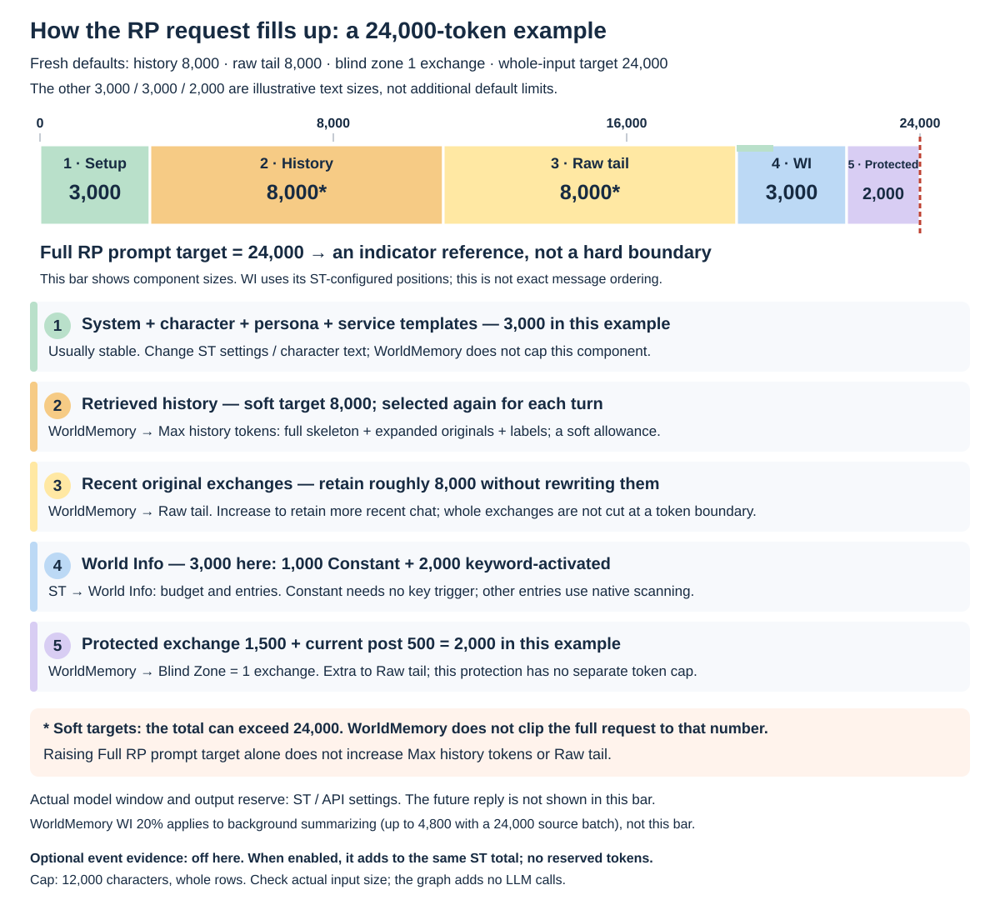
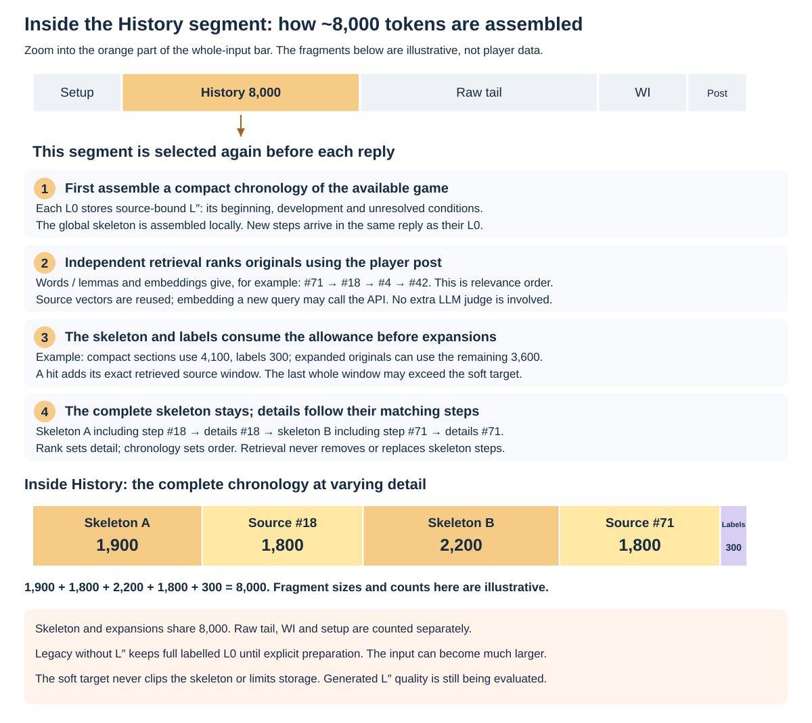
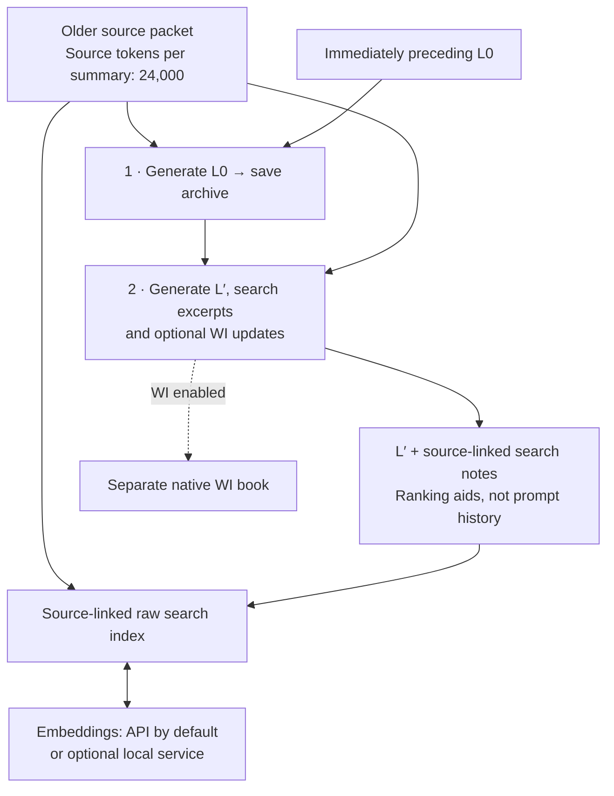
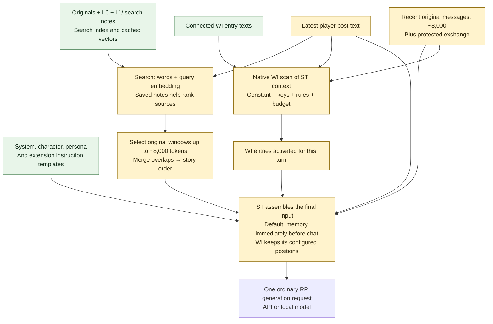

# WorldMemory for SillyTavern

[Русский — полная инструкция](README_RU.md) · [Detailed reference](docs/REFERENCE.md) · [Changes](CHANGELOG.md)

> **Not cache-friendly:** WorldMemory rebuilds the retrieved history sent for inference on each turn. This can reduce reuse of your API provider's prompt/input-token cache, although unchanged parts of the request may still benefit from caching.

**Keep earlier story events within reach as your chat grows.** WorldMemory saves source-linked summaries of older messages, retrieves relevant history for the next reply, and maintains a separate World Info reference book for characters and other entities.

**0.3.3 · standalone preview.** No Summaryception installation is needed. API embeddings are the default; a local model is optional.

## What the model receives

For a normal chat reply, SillyTavern combines your character/setup, recent chat, selected earlier history and active World Info. **WorldMemory never inserts its entire archive into every reply.**

| Part | Purpose | Default |
| --- | --- | --- |
| **Raw tail (tokens)** | Keep recent messages in their original form | 8,000 tokens |
| **Max history tokens (soft target)** | Retrieve relevant earlier source excerpts in story order; edited or source-less summaries are labelled | 8,000 tokens, soft target |
| **World Info · entity reference** | Supply reference entries through ST's native activation and budget | Separate chat-scoped book |
| **Full RP prompt target (tokens)** | Show a size reference for the whole input, including character/setup and WI | 24,000 tokens, soft target |

Raw chat and retrieved history have separate allowances. Whole history fragments can exceed their target; the full-prompt target is not a hard cap on ST's request. Neither limits the saved archive.

**History answers “what happened?”; WI answers “who or what is this?”** History can recover a conversation in which a workshop keeper lent a visitor a key until morning. The keeper's WI entry describes the person, workshop and relevant relationships. It is reusable reference, not another scene-by-scene diary.

## Prompt fill bar: defaults and controls

The bar is a **numeric example** for a fresh installation: history 8,000 + raw tail 8,000 + setup 3,000 + WI 3,000 + protected exchange/current post 2,000 = **24,000 input tokens**. Only the two 8,000 settings, protection of 1 exchange and whole-input target 24,000 are defaults; the other sizes are illustrative. Each segment names its control and the restriction that actually applies.



**24,000 − 8,000 − 8,000 leaves roughly 8,000 for everything else: a planning example, not a reserved quota.** Character and WI size depend on your ST settings. The input can exceed the target; whole exchanges and source fragments are not clipped to fit this arithmetic. Set the model's context window and output reserve separately in ST. Token counts are estimates and can differ from provider usage.

| Part | How it is assembled |
| --- | --- |
| **History: 8,000** | The latest player post is the search query. Words/word forms and, by default, embeddings rank source windows. Linked L′/notes help locate them. Whole windows with neighboring fragments are selected to the soft target, overlaps merge, and results follow source order. Edited or source-less summaries can appear as labelled memories. |
| **Raw tail: 8,000 + protection** | Recent whole exchanges stay verbatim. By default, the latest **1 completed exchange** and any unanswered post are protected from summarization/automatic hiding and excluded from that 8,000-token count. More originals can remain while older packets await processing. |
| **WI in the RP request** | Entry text is stored, but activation is checked each turn. Enabled Constant entries need no keyword trigger; other entries depend on keys and conditions. Native ST rules and budget still apply. RussianWI adds word forms; semantic WI is off by default. Generated WI defaults to System at in-chat depth 2; author entries retain their own positions. Retrieved history is not itself added to the WI scan by default. |
| **Stable instructions** | System prompt, character, persona and enabled service instructions use the remaining space. Max history tokens does not set their size. |

### Inside History: from search to the 8,000-token segment



Search first ranks candidates by relevance. WorldMemory then selects whole original-text windows, merges overlaps, and sends the selection **in source-message order**, not rank order. The wrapper and labels also count toward Max history tokens. Other candidates remain archived; there is no fixed fragment count. Linked L′/notes help selection but are not added as a complete timeline in the prompt.

**Two different WI budgets:** **WI context allowance = 20%** applies to the **separate summarizer request**. With Source tokens per summary = 24,000, that allows up to **4,800 WI tokens**. It does not reserve 20% of the RP prompt. Configure the ordinary RP WI budget in ST's own World Info settings. Likewise, 24,000 source tokens is not the complete background request size: previous L0, instructions and selected WI add overhead.

These are fresh-install defaults; updates/imports can retain your earlier settings. Indexes and vectors are reused: the selection is rebuilt each turn, not the entire archive. There is no extra LLM judge/verifier call for each RP reply.

## Two paths: saving memory and answering a turn

**When an older packet is ready** — two sequential summarizer calls, not two calls on every RP turn:



The archive, source links, index and WI are stored/managed on your ST installation. Calls 1–2 use your summarizer connection: remote API or a local model. Embeddings send index text and queries to the selected API or local service; only new/changed inputs need new vectors, and cached vectors are reused. This preparation can also be started manually.

**For each ordinary RP reply** — local retrieval and native WI activation feed the regular ST request:



Prompt ingredients are **character/setup + selected history excerpts + raw tail + active WI + current post**; actual placement follows your ST/WorldMemory settings. L′ helps rank sources; it is not automatically inserted as a timeline, and the full archive is not sent. Manual edits and summaries without originals can appear as explicitly labelled memories. Ranking and source-span checks are local; retrieval needs no extra LLM verifier. With semantic search enabled, query embeddings may call the chosen service each turn (cached inputs are reused). Native keyword/Constant activation and RussianWI word forms run locally; semantic WI only adds candidates to that same native scan.

## Install and connect

1. In SillyTavern, open **Extensions → Install extension** and paste:

   ```text
   https://github.com/Ilya626/Extension-WorldMemory
   ```

   Install, reload the page, open a character chat, then **Extensions → WorldMemory**.
2. Under **Summarizer connection → Connection**, select your background generation connection: **Current SillyTavern connection**, **SillyTavern Connection Profile**, **OpenAI-compatible API**, or **Ollama**. Complete the fields shown. Choose **L0 language**; **Response token override** at `0` inherits the connection setting.
3. Under **Search and embeddings**, configure the embedding API. New installations enable **Search history by meaning (embeddings)** with **Embedding connection → API embeddings**:

   | Field | Starting value |
   | --- | --- |
   | **API URL** | Your provider's embedding API base URL; for Google's native API, `https://generativelanguage.googleapis.com` |
   | **API key** | The key for that endpoint |
   | **API format** | **Google / Gemini embeddings** |
   | **Embedding model** | `gemini-embedding-001` |
   | **Advanced embedding API settings → Dimensions** | `768` |

   For an OpenAI-style endpoint, select **OpenAI-compatible embeddings** and enter its supported embedding model and dimensions. A chat model name is not an embedding model.

   **Blank URL/key fields inherit only from WorldMemory's own OpenAI-compatible API summarizer settings.** Native ST connections and Connection Profiles do not expose their saved credentials here; enter embedding URL/key explicitly. ST Vector Storage settings are not used.
4. Keep **Enable WorldMemory** on. In **World Info · entity reference**, leave **Prepare and apply WI after saving L0** on if you want generated references. **Also find WI by meaning** is separate and off by default.
5. Continue chatting. Older eligible messages are summarized automatically when a source packet is ready; **Summarize** starts this manually. Inspect saved memories in **L0 archive** and references with **Open lorebook**.

No local weights or compiler are needed for API embeddings. Without embeddings, keyword history search remains available. Optional [Russian WI Forms](https://github.com/Ilya626/Extension-RussianWI) adds Russian word-form matching to native WI keys, for example `меч` → `мечом`.

**Addon checklist:** WorldMemory is standalone. Install Russian WI Forms as well for Russian keyword inflections; its dictionary is bundled. Summaryception, MemoryBooks, MarkUps, Tavern Helper and ST Vector Storage are not required. Configure your RP model, background summarizer and embedding endpoint separately; an embedding API is a connection, not another addon. [Installation, native updates and importing a prepared chat — Russian guide](docs/INSTALL_AND_PLAY_RU.md).

## How memory grows

**L0** is a saved narrative summary of one source packet. WorldMemory keeps a growing archive of these packets, without layer transfers or repeatedly squeezing the whole chat into one summary.

A new packet uses **two sequential background generation requests** through the summarizer connection:

1. **Write and save L0.** The model receives the packet's original messages and the **complete immediately preceding L0** for continuity. The new L0 is saved before the next step.
2. **Prepare search notes and optional WI.** The model receives the saved L0 and the same originals to prepare a short navigation thread (L′), source-linked search excerpts and entity-reference updates. Previous summaries and WI help identify subjects; the packet's originals supply evidence for new claims.

These requests are separate from your ordinary chat reply. Embedding requests also send indexed text and search queries to the configured embedding service. Changed sources are indexed as needed; unchanged vectors are reused. Background generation can receive native WI as read-only context, controlled by **Advanced summarizer context**.

The default source packet is 24,000 tokens. The raw tail and **BlindZone (recent exchanges)** protect recent messages; BlindZone defaults to one exchange. Find these settings and **Pause automatic summarization** under **Advanced history and packet settings**. Original messages remain in the chat; hiding controls decide which summarized messages are sent to the model. Reapplying automatic hiding is off by default to preserve manual visibility choices.

## Review, edit and recover

- **Edit L0:** expand a packet and use **Save text**. **Regenerate** rewrites it from linked sources; **Refine** also supplies your existing text. **Advanced summary prompts** exposes saved/custom L0 system instructions and the user template; it controls L0 prose only, not the separate search-note/WI instructions.
- **If search-note/WI preparation fails:** L0 stays saved. Use **Rebuild search notes / WI** for one packet or **Prepare missing search notes / WI** for unfinished packets. These repeat the second request without rewriting L0. **Apply saved WI** reapplies saved results locally, without a model request.
- **Protect a WI edit:** use **Keep manual**; **Allow automatic updates** opts the entry back in. Author lorebooks and bindings stay intact. Generated entries follow ST's keyword, Constant, group and budget rules; semantic WI adds candidates to that same scan.
- **If sources change:** affected L0 is marked **SOURCES CHANGED** and stale retrieval evidence is excluded. Regenerate that packet to refresh it. Manual WI edits and visibility choices are preserved.

[Detailed controls, placement, search and backups](docs/REFERENCE.md) · [Optional local EmbeddingGemma 2 Q8: Windows and Termux preview](docs/LOCAL_EMBEDDINGS.md)

## Update or migrate

Export **WorldMemory → Portable backup → Export backup**, and export the ST chat separately to retain originals and swipes. Update **World Memory** through ST's extension manager, then reload. **Existing preferences are preserved**; updating does not enable semantic search if you previously disabled it.

Previously disabled history migrates to **Advanced history insertion → Insert retrieved history → Off — do not send history**. To enable it, choose an insertion position there, for example **Immediately before chat history**.

For an existing Summaryception setup, WorldMemory imports the saved archive and relevant settings. If the old extension is active, WorldMemory saves the import, disables the old runtime and reloads once. Inspect **L0 archive** before continuing; do not run both archive writers for the same chat. Imported summaries without available originals remain summary-only.

**Import backup replaces the receiving chat's WorldMemory state.** Export that state first. A lorebook alone cannot restore history; keep both the WorldMemory backup and the original chat.

## Preview limits

### Tested setup

WorldMemory's background prompts and instruction-following were developed, tested and tuned primarily with Sol 6.1 (`gpt-6.1-sol`). This covers new L0 generation, search metadata and World Info preparation. Existing test archives also contain imported Gemini/Anthropic summaries and earlier story summaries. Prompt compliance and output quality with other summarizer models have not been established by these Sol experiments; the RP model consuming the prepared memory is a separate choice.

Review important memories and references: generation can omit details or confuse identity and conditions; retrieval depends on the query, sources and models. This preview does not promise complete recall. Local embeddings are optional; the Termux-Gemma scripts remain a preview, with real-phone qualification deferred.

License: [AGPL-3.0](LICENSE) · [Third-party notices](THIRD_PARTY_NOTICES.md). Bundled Summaryception modules retain their [vendor license](vendor/summaryception/LICENSE).
