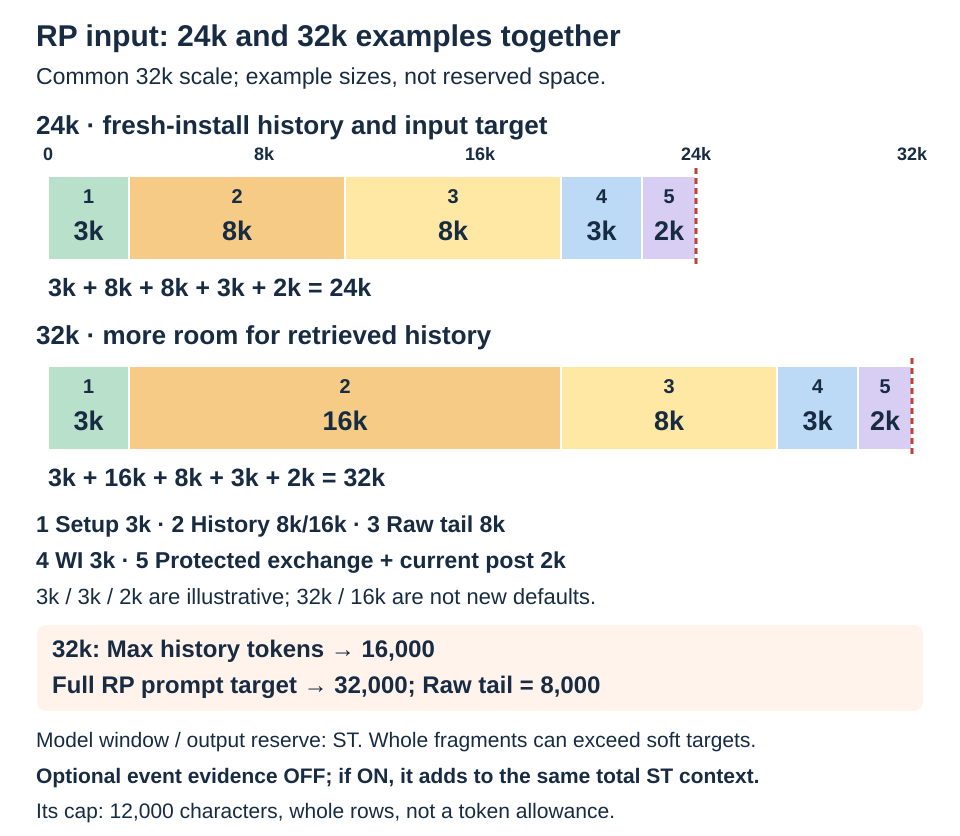
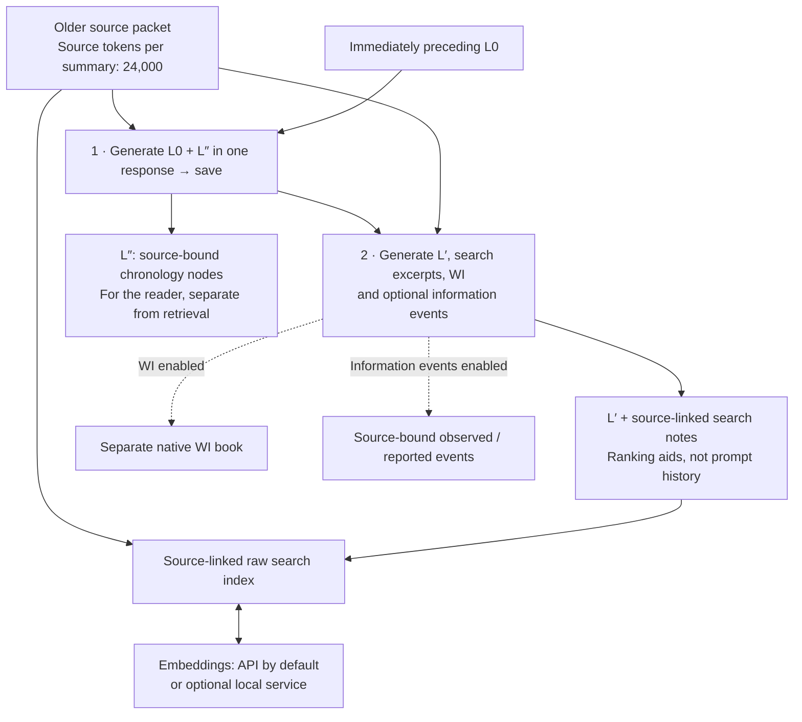
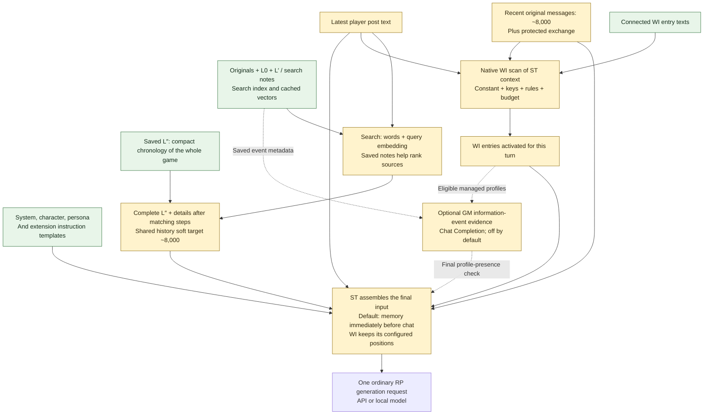

# WorldMemory for SillyTavern

[Русский — полная инструкция](README_RU.md) · [Detailed reference](docs/REFERENCE.md) · [Changes](CHANGELOG.md)

> **Not cache-friendly:** WorldMemory rebuilds the retrieved history sent for inference on each turn. This can reduce reuse of your API provider's prompt/input-token cache, although unchanged parts of the request may still benefit from caching.

**Keep earlier story events within reach as your chat grows.** WorldMemory saves source-linked summaries of older messages, retrieves relevant history for the next reply, and maintains a separate World Info reference book for characters and other entities.

**0.5.0 · standalone preview.** No Summaryception installation is needed. API embeddings are the default; a local model is optional.

**Complete chronological outline (L″).** The entire available outline remains in each history-enabled prompt; independently retrieved originals follow their matching steps. New L0 packets include a short outline in the same model response. Older archives need explicit preparation; until then, complete labelled L0 accounts remain and can greatly exceed the target. Manual text is preserved. The growing L0 archive, full L″ and normal retrieval are unchanged in 0.5.0. [Earlier outline validation](docs/VALIDATION_0_4.md).

**New, optional NPC information events.** The existing second background request can also record source-bound `observed` / `reported` events for managed character profiles. A separate optional local graph adds related evidence without an LLM call. **Both controls default to off.** The limited comparison gave mixed results and did not establish an overall RP improvement. [0.5.0 measured scope and limits](docs/VALIDATION_0_5.md).

## What the model receives

For a normal chat reply, SillyTavern combines your character/setup, recent chat, selected earlier history and active World Info. **WorldMemory never inserts its entire archive into every reply.**

| Part | Purpose | Default |
| --- | --- | --- |
| **Raw tail (tokens)** | Keep recent messages in their original form | 8,000 tokens |
| **Max history tokens (soft target)** | Shared allowance for the complete skeleton, in-place original passages and labels; raw tail is separate | 8,000 tokens, soft target |
| **World Info · entity reference** | Supply reference entries through ST's native activation and budget | Separate chat-scoped book |
| **Full RP prompt target (tokens)** | Show a size reference for the whole input, including character/setup and WI | 24,000 tokens, soft target |

Raw chat and retrieved history have separate allowances. Whole history fragments can exceed their target; the full-prompt target is not a hard cap on ST's request. Neither limits the saved archive.

**History answers “what happened?”; WI answers “who or what is this?”** History can recover a conversation in which a workshop keeper lent a visitor a key until morning. The keeper's WI entry describes the person, workshop and relevant relationships. It is reusable reference, not another scene-by-scene diary.

## Prompt fill bar: defaults and controls

The bar is a **numeric example** for a fresh installation: history 8,000 + raw tail 8,000 + setup 3,000 + WI 3,000 + protected exchange/current post 2,000 = **24,000 input tokens**. Only the two 8,000 settings, protection of 1 exchange and whole-input target 24,000 are defaults; the other sizes are illustrative. Each segment names its control and the restriction that actually applies.


**Compare with 32,000 input tokens:** keep setup 3,000 + raw tail 8,000 + WI 3,000 + protected exchange/current post 2,000, and increase history from 8,000 to **16,000**. Change **Max history tokens → 16,000** and **Full RP prompt target → 32,000**; raising only the latter does not enlarge history. These are example settings, not new defaults. The remaining component sizes stay illustrative.



**24,000 − 8,000 − 8,000 leaves roughly 8,000 for everything else: a planning example, not a reserved quota.** Character and WI size depend on your ST settings. The input can exceed the target; whole exchanges and source fragments are not clipped to fit this arithmetic. Set the model's context window and output reserve separately in ST. Token counts are estimates and can differ from provider usage.

**Optional information-event context is off in this example.** When enabled and delivered, it adds to the same total ST input: the parts above **+ the optional GM evidence**. ST counts it during prompt assembly. Its cap is **12,000 characters in whole rows**, not a token allowance or reserved space; check the actual assembled prompt and leave room within your model's context window.

| Part | How it is assembled |
| --- | --- |
| **History: 8,000** | First assemble the complete available chronological L″. Independently rank originals using the player post, words/lemmas and embeddings. Every compact skeleton step stays present. Retrieved passages are added immediately after their matching steps. The skeleton and labels consume the allowance first, then whole expansions use the remainder. Overflow is reported. |
| **Raw tail: 8,000 + protection** | Recent whole exchanges stay verbatim. By default, the latest **1 completed exchange** and any unanswered post are protected from summarization/automatic hiding and excluded from that 8,000-token count. More originals can remain while older packets await processing. |
| **WI in the RP request** | Entry text is stored, but activation is checked each turn. Enabled Constant entries need no keyword trigger; other entries depend on keys and conditions. Native ST rules and budget still apply. RussianWI adds word forms; semantic WI is off by default. Generated WI defaults to System at in-chat depth 2; author entries retain their own positions. Retrieved history is not itself added to the WI scan by default. |
| **Stable instructions** | System prompt, character, persona and enabled service instructions use the remaining space. Max history tokens does not set their size. |

### Inside History: from search to the 8,000 / 16,000-token segment


The cutaway expands **segment 2** of the bars above. In this numerical example the same full L″ uses **4,100 tokens** (A 1,900 + B 2,200), with **300** for labels. That leaves **3,600** for whole retrieved passages within history 8,000, or **11,600** within history 16,000. More allowance can admit more source detail; it does not double the skeleton. Actual sizes and selected passages depend on the archive and query, and whole fragments can exceed either soft target.

The request contains one timeline: **step A → step B + details B → step C → step D + details D**, followed by recent raw chat. The entire short L″ always remains in the prompt, giving the answering model the whole story; L′/search notes support retrieval and do not replace chronology. Search failure keeps the skeleton. Manually visible archived messages can repeat; a warning and reader instruction retain their status as older events. Removing them before final ST trimming could lose their only representation.

**Two different WI budgets:** **WI context allowance = 20%** applies to the **separate summarizer request**. With Source tokens per summary = 24,000, that allows up to **4,800 WI tokens**. It does not reserve 20% of the RP prompt. Configure the ordinary RP WI budget in ST's own World Info settings. Likewise, 24,000 source tokens is not the complete background request size: previous L0, instructions and selected WI add overhead.

These are fresh-install defaults; updates/imports can retain your earlier settings. Indexes and vectors are reused: the selection is rebuilt each turn, not the entire archive. There is no extra LLM judge/verifier call for each RP reply.

## Two paths: saving memory and answering a turn

**When an older packet is ready** — two sequential summarizer calls, not two calls on every RP turn:



The archive, source links, index and WI are stored/managed on your ST installation. Calls 1–2 use your summarizer connection: remote API or a local model. Embeddings send index text and queries to the selected API or local service; only new/changed inputs need new vectors, and cached vectors are reused. This preparation can also be started manually.

**For each ordinary RP reply** — local retrieval and native WI activation feed the regular ST request:



Prompt ingredients are **character/setup + complete L″ with in-place source expansions + raw tail + active WI + current post**. L′ supports retrieval; L″ supplies chronology. Legacy without a skeleton keeps full labelled L0 until explicit preparation, so its prompt may be much larger. Authored text remains authoritative. Placement follows ST/WorldMemory settings. Ranking and address checks are local; no extra LLM judge is required. Semantic search may call the selected query-embedding service. Native keys/Constant and RussianWI run locally; semantic WI adds candidates to the same native scan.

## Install and connect

1. In SillyTavern, open **Extensions → Install extension** and paste:

   ```text
   https://github.com/Ilya626/Extension-WorldMemory
   ```

   Install, reload the page, open a character chat, then **Extensions → WorldMemory**.
2. Under **Summarizer connection → Connection**, select your background generation connection: **Current SillyTavern connection**, **SillyTavern Connection Profile**, **OpenAI-compatible API**, or **Ollama**. Complete the fields shown. Choose **L0 language**; **Response token override** at `0` inherits the connection setting.
3. Under **Search and embeddings**, configure the embedding API. New installations enable **Search history by meaning (embeddings)** with **Embedding connection → API embeddings**:

   | Field | Starting value |
   | --- | --- |
   | **API URL** | Your provider's embedding API base URL; for Google's native API, `https://generativelanguage.googleapis.com` |
   | **API key** | The key for that endpoint |
   | **API format** | **Google / Gemini embeddings** |
   | **Embedding model** | `gemini-embedding-001` |
   | **Advanced embedding API settings → Dimensions** | `768` |

   For an OpenAI-style endpoint, select **OpenAI-compatible embeddings** and enter its supported embedding model and dimensions. A chat model name is not an embedding model.

   **Blank URL/key fields inherit only from WorldMemory's own OpenAI-compatible API summarizer settings.** Native ST connections and Connection Profiles do not expose their saved credentials here; enter embedding URL/key explicitly. ST Vector Storage settings are not used.
4. Keep **Enable WorldMemory** on. In **World Info · entity reference**, leave **Prepare and apply WI after saving L0** on if you want generated references. **Also find WI by meaning** is separate and off by default.
5. Continue chatting. Older eligible messages are summarized automatically when a source packet is ready; **Summarize** starts this manually. Inspect saved memories in **L0 archive** and references with **Open lorebook**.

No local weights or compiler are needed for API embeddings. Without embeddings, keyword history search remains available. Optional [Russian WI Forms](https://github.com/Ilya626/Extension-RussianWI) adds Russian word-form matching to native WI keys, for example `меч` → `мечом`.

**Addon checklist:** WorldMemory is standalone. Install Russian WI Forms as well for Russian keyword inflections; its dictionary is bundled. Summaryception, MemoryBooks, MarkUps, Tavern Helper and ST Vector Storage are not required. Configure your RP model, background summarizer and embedding endpoint separately; an embedding API is a connection, not another addon. [Installation, native updates and importing a prepared chat — Russian guide](docs/INSTALL_AND_PLAY_RU.md).

## How memory grows

**L0** is a saved narrative summary of one source packet. WorldMemory keeps a growing archive of these packets, without layer transfers or repeatedly squeezing the whole chat into one summary.

A new packet uses **two sequential background generation requests** through the summarizer connection:

1. **Write and save L0.** The model receives the packet's original messages and the **complete immediately preceding L0** for continuity. The new L0 is saved before the next step.
2. **Prepare search notes and optional WI.** The model receives the saved L0 and the same originals to prepare a short navigation thread (L′), source-linked search excerpts and entity-reference updates. When enabled, information events are another optional field in this same response. Previous summaries and WI help identify subjects; the packet's originals supply evidence for new claims.

These requests are separate from your ordinary chat reply. Embedding requests also send indexed text and search queries to the configured embedding service. Changed sources are indexed as needed; unchanged vectors are reused. Background generation can receive native WI as read-only context, controlled by **Advanced summarizer context**.

The default source packet is 24,000 tokens. The raw tail and **BlindZone (recent exchanges)** protect recent messages; BlindZone defaults to one exchange. Find these settings and **Pause automatic summarization** under **Advanced history and packet settings**. Original messages remain in the chat; hiding controls decide which summarized messages are sent to the model. Reapplying automatic hiding is off by default to preserve manual visibility choices.

## Optional NPC information events

Under **World Info · entity reference**, **Track NPC information events (experimental)** records who directly observed information (`observed`) or received a statement (`reported`). A received statement is not automatically true or believed. Missing events do not prove ignorance; later original dialogue can establish discovery. The GM keeps access to the whole story and its secrets. Exact quotations and code-bound source ranges establish provenance, not correct interpretation.

**Include related source evidence (local graph, experimental)** separately links those events through actors, original messages and exactly matching topics. Acquaintance does not transfer knowledge. It runs locally with **zero extra LLM calls** and needs no graph service or extra embedding model. Both settings are off by default; the graph needs event tracking enabled.

To try it:

1. Configure ordinary WI preparation and use **Chat Completion** for RP. Enable **Track NPC information events (experimental)**; leave the graph off initially.
2. For an existing archive, use **Rebuild search notes / WI** on the desired packet, or **Prepare missing search notes / WI** for pending packets. These are explicit second-stage requests, without rewriting L0. Only character profiles already managed when a request starts are eligible for events.
3. If the archive has no managed character profiles, first prepare/apply its WI profiles. Then explicitly rebuild the relevant packets' search notes / WI to prepare events for those identities. A completed annotation may need **Rebuild**, not **Prepare missing**. There is no automatic two-pass onboarding guarantee.
4. Let native WI select profiles for the next reply and inspect the assembled prompt or `WorldMemory.inspectKnowledge()`. Enable the graph separately if you want to compare related evidence.

The addition follows the **final native WI selection**, including keywords, Constant, groups, probability and budget, with native regex/depth handling. It is separate GM context and is not scanned for more WI. A final Chat Completion prompt check withholds it if a selected profile is missing. Delivery is checked by rendered text; this is not a native UID trace through every third-party transformation. Other API modes retain stored events without this new injection.

The added context is capped at **12,000 characters**, retaining whole rows. An oversized graph view falls back to direct events, preferring recent rows while keeping source order. This cap neither allocates tokens nor limits the archive. Normal preparation still uses **two background generation calls per ready packet**; enabling events adds no permanent third call or per-turn LLM call. Explicit older-archive preparation can require additional requests as described above.

Source edits, unavailable/hidden evidence, changed L0 or replaced character identities can invalidate events. Missing or unsupported event output preserves saved L0 and valid search/WI data; an empty event array is valid. Previously stored experimental epistemic rows remain available as legacy data; new preparation requests the simpler information events. [Technical boundaries](docs/KNOWLEDGE_BOUNDARIES.md) · [Measured results](docs/VALIDATION_0_5.md).

## Review, edit and recover

- **Edit L0:** expand a packet and use **Save text**. **Regenerate** rewrites it from linked sources; **Refine** also supplies your existing text. **Advanced summary prompts** exposes saved/custom L0 system instructions and the user template; it controls L0 prose only, not the separate search-note/WI instructions.
- **If search-note/WI preparation fails:** L0 stays saved. Use **Rebuild search notes / WI** for one packet or **Prepare missing search notes / WI** for unfinished packets. These repeat the second request without rewriting L0. **Apply saved WI** reapplies saved results locally, without a model request.
- **Prepare an older archive's outline:** use **Prepare missing story skeleton** in **L0 archive**. This makes one summarizer request per missing packet using its saved L0; it preserves that L0 and its originals. An invalid outline never discards a valid L0. Editing L0 invalidates its derived outline; prepare it again explicitly.
- **Protect a WI edit:** use **Keep manual**; **Allow automatic updates** opts the entry back in. Author lorebooks and bindings stay intact. Generated entries follow ST's keyword, Constant, group and budget rules; semantic WI adds candidates to that same scan.
- **If sources change:** affected L0 is marked **SOURCES CHANGED** and stale retrieval evidence is excluded. Regenerate that packet to refresh it. Manual WI edits and visibility choices are preserved.

[Detailed controls, placement, search and backups](docs/REFERENCE.md) · [Optional local EmbeddingGemma 2 Q8: Windows and Termux preview](docs/LOCAL_EMBEDDINGS.md)

**Experimental outline ranking** is off by default under **Search and embeddings**. It reuses the player-query embedding and caches outline vectors, then makes small changes to the existing candidate order. It never restricts search to one scene or removes outline steps. In the paired retrieval trial, four support observations improved and one worsened: net +3, not a guarantee of better RP replies. No extra generative call is added per turn.

## Update or migrate

Export **WorldMemory → Portable backup → Export backup**, and export the ST chat separately to retain originals and swipes. Update **World Memory** through ST's extension manager, then reload. **Existing preferences are preserved**; updating does not enable semantic search if you previously disabled it.

Previously disabled history migrates to **Advanced history insertion → Insert retrieved history → Off — do not send history**. To enable it, choose an insertion position there, for example **Immediately before chat history**.

For an existing Summaryception setup, WorldMemory imports the saved archive and relevant settings. If the old extension is active, WorldMemory saves the import, disables the old runtime and reloads once. Inspect **L0 archive** before continuing; do not run both archive writers for the same chat. Imported summaries without available originals remain summary-only.

**Import backup replaces the receiving chat's WorldMemory state.** Export that state first. A lorebook alone cannot restore history; keep both the WorldMemory backup and the original chat.

## Preview limits

### Tested setup

WorldMemory's background prompts and instruction-following were developed, tested and tuned primarily with Sol 6.1 (`gpt-6.1-sol`). This covers new L0 generation, search metadata, World Info and optional information-event preparation. The reported reply comparisons used Flash 3.8. Existing test archives also contain imported Gemini/Anthropic summaries and earlier story summaries. These experiments do not establish universal prompt compliance or RP quality across models; the RP model consuming the prepared memory is a separate choice. The narrow native event run checked preparation, persistence and delivery, not every authorization mode, physical-phone behavior or general gameplay quality.

Review important memories and references: generation can omit details or confuse identity and conditions; retrieval depends on the query, sources and models. This preview does not promise complete recall. Local embeddings are optional; the Termux-Gemma scripts remain a preview, with real-phone qualification deferred.

License: [AGPL-3.0](LICENSE) · [Third-party notices](THIRD_PARTY_NOTICES.md). Bundled Summaryception modules retain their [vendor license](vendor/summaryception/LICENSE).
