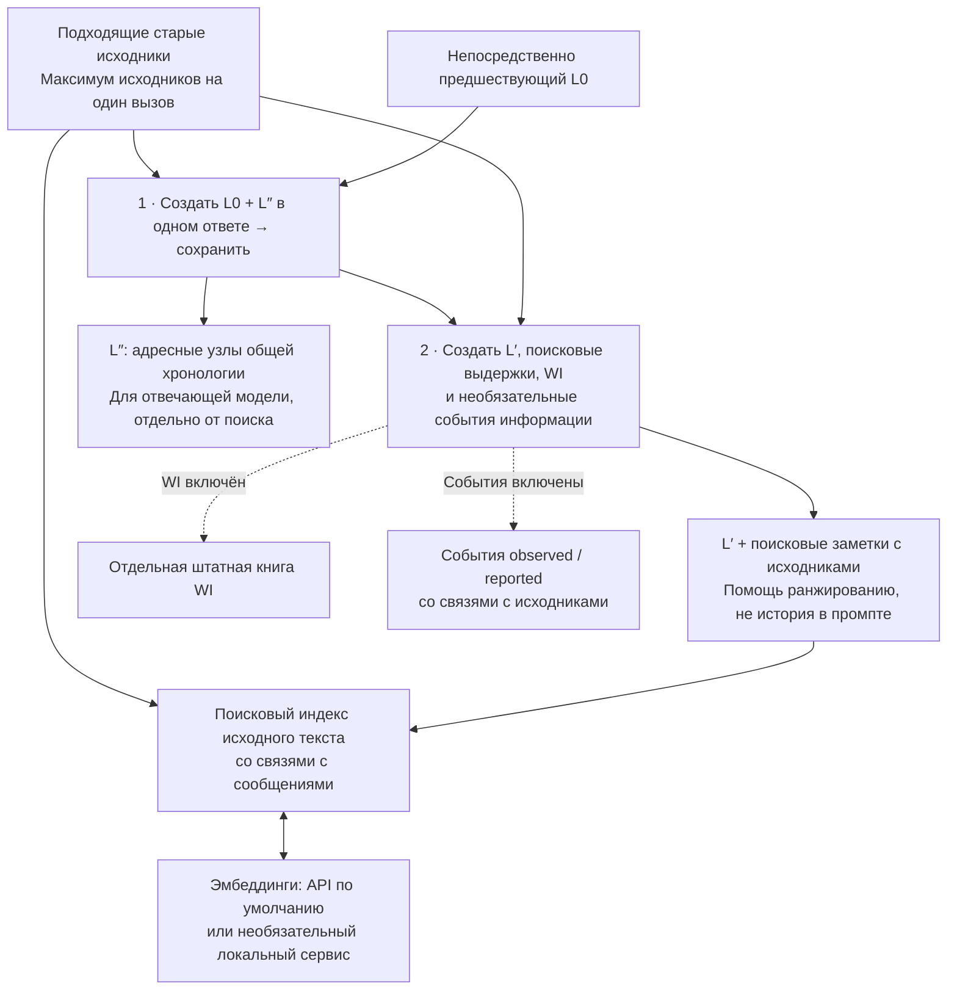
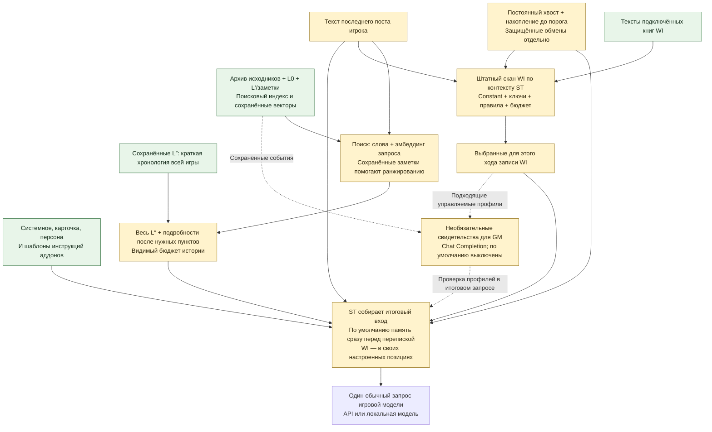

# WorldMemory для SillyTavern

[English](README.md) · [Подробная инструкция](docs/REFERENCE_RU.md) · [Изменения](CHANGELOG.md)

> **Аддон не cache-friendly:** WorldMemory каждый ход пересобирает восстановленную историю, отправляемую на инференс. Это может снижать переиспользование кэша промпта/входных токенов у API-провайдера; неизменные части запроса при этом могут по-прежнему кэшироваться.

**Возвращайте нужные события прошлой истории по мере роста чата.** WorldMemory сохраняет резюме старых сообщений со связями с исходниками, подбирает нужную историю для следующего ответа и ведёт отдельную справочную книгу World Info о персонажах и других сущностях.

**0.5.2 · самостоятельная preview-версия.** Устанавливать Summaryception не нужно. По умолчанию используются API-эмбеддинги; локальная модель необязательна.

## Начните с рекомендуемого варианта

1. На главном экране задайте **Desired context (tokens) · Желаемый контекст**, затем нажмите **Recommend values for this context · Подобрать значения**. Рекомендованные значения остаются видимыми и редактируемыми. Обновление само эту кнопку не применяет.
2. Настройте **Summarizer connection** для фоновой подготовки памяти. Игровая модель задаётся в обычном подключении ST.
3. В **Search and embeddings** укажите URL/ключ провайдера. Рекомендуется **gemini-embedding-2-preview, 768 измерений**; локальная модель не нужна.
4. Продолжайте игру. Сразу видны защищённые обмены, постоянный хвост, порог сжатия, максимум сырого контекста, ёмкость истории, бюджет активации WI, скрытые подсказки и фактические размеры. Архив и эксперименты раскрывайте по необходимости.

Желаемый контекст служит для рекомендаций, **а не жёстким пределом**. Ручное изменение одного поля не уменьшает скрытно историю, WI или порог сжатия. Нижняя панель считает ваш выбор: **план N = история H + постоянный хвост R + порог T + WI W + инструкции F**, разницу с целью C и **защищённые обмены P отдельно**. При плане 32k фактический вход может быть **32k + P**; целые фрагменты, полный L″ и очередь сжатия могут добавить превышение. Окно модели и резерв ответа задаются отдельно в ST.

| Цель C | История H | Хвост R | Порог T | WI W | Резерв инструкций F |
| --- | --- | --- | --- | --- | --- |
| 32 000 | 12 000 | 8 000 | 4 000 | 4 000 | 4 000 |
| 24 000 | 8 000 | 6 000 | 3 000 | 3 000 | 4 000 |

Это рекомендации кнопки, а не ограничения ручных значений. История содержит **весь доступный L″ и найденные оригинальные выдержки**. WI использует штатную активацию и словоформы Russian WI Forms. Скрытые поисковые подсказки рекомендуются включёнными; семантическая WI, rerank и эксперименты NPC/графа выключены. Неограниченная WI включается явно и может вывести план за желаемый контекст.

Модель выбрана по сравнению двух игр: при условных 32k preview доставила четыре дополнительных полных подтверждения потребностей естественных постов без потерь поддержки. Это измерение найденных свидетельств, а не улучшения RP-ответов; на других входах были отдельные потери. Hints оставлены как инженерный default без сравнительного on/off-результата. Rerank и NPC/граф дали смешанные результаты; для semantic WI ещё нет сопоставимого игрового подтверждения. [Выбор и ограничения](docs/FEATURE_DEFAULTS.md).

**Что устанавливать:** [WorldMemory](https://github.com/Ilya626/Extension-WorldMemory) и, для русских словоформ ключей WI, [Russian WI Forms](https://github.com/Ilya626/Extension-RussianWI). Словарь уже включён во второй аддон. Summaryception, MemoryBooks, MarkUps, Tavern Helper и ST Vector Storage для работы WorldMemory не требуются. [Короткая инструкция: установка, обновление и импорт готового чата](docs/INSTALL_AND_PLAY_RU.md).

**Полная хронология L″.** Весь доступный короткий скелет остаётся в каждом запросе с включённой историей; независимо найденные оригиналы добавляются после соответствующих пунктов. Новый L0 получает краткий скелет тем же ответом модели. Старым архивам нужна явная подготовка; до неё остаётся полный подписанный L0, который может сильно превысить ориентир. Ручные тексты сохраняются. Растущий архив L0, весь L″ и обычный поиск в 0.5.0 не изменились. [Прежняя проверка скелета](docs/VALIDATION_0_4.md).

## Что получает модель

Для обычного игрового ответа SillyTavern собирает карточку и инструкции, свежие сообщения, выбранную раннюю историю и активный World Info. **Компактный L″ охватывает всю доступную историю, найденные детали раскрывают её нужные места.**

| Поле на главном экране | Что означает |
| --- | --- |
| **Desired context · Желаемый контекст** | Цель для рекомендаций; защищённые обмены находятся вне неё. |
| **Protected exchanges · BlindZone** | Последние завершённые обмены и неотвеченный пост не сжимаются. Их фактический размер P показан отдельно. |
| **Permanent raw tail · Постоянный хвост R** | Свежие оригиналы, остающиеся после сжатия, помимо защищённых обменов. |
| **Compression trigger · Порог сжатия T** | Сколько подходящего старого сырого текста может накопиться сверх постоянного хвоста до начала сжатия. |
| **Maximum raw before compression · Хвост + порог** | Нередактируемая сумма **R + T**. Защищённый текст P добавляется отдельно; целые сообщения и очередь обработки могут превысить это плановое значение. |
| **History allowance · История H** | Весь доступный L″ + найденные оригинальные выдержки + подписи. Рядом показаны размер полного L″, использованные детали и свободный остаток. |
| **WI activation allowance / Unlimited WI** | Бюджет W активации штатной WI с явной галочкой «без ограничения». Условия активации сохраняются. |
| **Hidden search hints · Скрытые поисковые подсказки** | Короткая заметка в том же ответе помогает поиску без дополнительной генерации. |
| **Резерв инструкций F** | Дополнительная настройка карточки/system/hints для планирования при отсутствии измерения. Всегда участвует в арифметике и не меняет остальные поля. |

Сводка отдельно показывает план, его разницу с целью, защищённый текст, фактический собранный промпт и превышение. Настройки не ограничивают архив и не гарантируют жёсткого предела API-запроса ST.

**История отвечает «что произошло?», WI — «кто или что это?»** История может восстановить разговор, в котором хозяин мастерской дал посетителю ключ до утра. Его WI-запись описывает самого человека, мастерскую и значимые связи. Это повторно используемая справка, а не второй дневник всех сцен.

<details>
<summary>Бюджеты контекста и числовые примеры — дополнительно</summary>

Рекомендации учитывают **постоянный хвост, рост до порога сжатия, историю, WI и инструкции вместе**. Один разрез «история + хвост» не учитывает место до следующего сжатия. Цель и рекомендации применяются кнопкой явно; без неё ручные значения сохраняются.

Нижняя арифметика показывает **N = H + R + T + W + F**, **N − C** и **+ защищённый P**. F — явный плановый резерв карточки/system/hints, а не измерение их размера. При неограниченной WI для численного учёта нужен её фактический активированный размер. Реальный размер промпта и превышение показаны отдельно от плана. Целые сообщения, полный L″, WI, другие расширения и ожидающее сжатие могут увеличить вход. Резерв ответа задаётся отдельно в ST.


Полосы показывают рекомендации кнопки, а не пределы ручных значений. Отдельный **+ P** переменный; фиксированного сегмента защиты внутри C нет. **B = 24k максимум исходников на вызов** ограничивает фоновый API-пакет и отличается от **T = 4k**, порога сжатия в рекомендации для 32k. [Отдельная схема 24k с той же арифметикой](docs/assets/prompt-budget-ru.svg).

### Разрез сегмента «История»: от поиска до 8 000 / 12 000 токенов


Разрез раскрывает **H8k / H12k** из рекомендаций. Его состав — численный пример: один и тот же полный L″ занимает **4 100 токенов** (A 1 900 + B 2 200), подписи — **300**. Для целых найденных выдержек остаётся **3 600** при истории 8 000 или **7 600** при истории 12 000. Больший бюджет может вместить больше исходных деталей; скелет не растёт. Реальные размеры L″ и выдержек меняются, а целые фрагменты могут превысить любой мягкий ориентир.

В запросе остаётся одна лента: **пункт A → пункт B + подробности B → пункт C → пункт D + подробности D**, затем свежий сырой хвост. Весь короткий L″ всегда остаётся в промпте. Он нужен отвечающей модели для целой истории, а L′/поисковые заметки помогают retrieval и не заменяют хронологию. Если поиск недоступен, скелет сохраняется. При ручном показе старых архивных сообщений возможны повторы: предупреждение и пояснение модели сохраняют их статус старых событий. Исключать их до окончательной обрезки ST небезопасно.

**Два разных бюджета WI:** настройка **WI context allowance = 20%** относится к **отдельному запросу суммаризатора**: при пакете исходников 24 000 это до **4 800 токенов WI**. Она не резервирует 20% игрового промпта. Для обычного RP служит поле **WI activation allowance / Unlimited WI** на главном экране; записи по-прежнему выбираются штатными условиями. Максимум 24 000 исходных токенов на вызов — не порог запуска сжатия и не полный размер фонового запроса: предыдущий L0, инструкции и выбранный WI добавляются отдельно.

Обновление и импорт сохраняют прежние настройки до явного применения рекомендуемого варианта. Индексы и векторы переиспользуются; каждый ход пересобирается подборка, а не пересоздаётся весь архив. Дополнительного LLM-запроса для оценки/проверки каждого игрового ответа нет.

</details>

## Два пути: сохранение памяти и игровой ответ

**Когда готов пакет старых сообщений** — два последовательных запроса суммаризатору, а не два запроса на каждом игровом ходу:



Архив, связи с исходниками, индекс и WI хранятся/обслуживаются в вашей установке ST. Запросы 1–2 идут через подключение суммаризатора: удалённый API или локальную модель. Эмбеддинги отправляют индексируемый текст и запросы выбранному API или локальному сервису; новые векторы нужны только для новых/изменённых входов, сохранённые переиспользуются. Подготовку можно запускать и вручную.

**Для каждого обычного RP-ответа** — локальный поиск истории и штатная активация WI готовят обычный запрос ST:



Состав промпта: **карточка/инструкции + полный L″ с раскрытиями исходников на местах + сырой хвост + активный WI + текущий пост**. L′ помогает поиску, L″ задаёт хронологию. Legacy без скелета сохраняет полный подписанный L0 до явной подготовки, поэтому запрос может сильно вырасти. Ручной текст остаётся авторским. Позиции задаются ST/WorldMemory. Ранжирование и проверка адресов локальные; дополнительного LLM-судьи нет. При смысловом поиске эмбеддинг запроса может обращаться к выбранному сервису. Штатные ключи/Constant и RussianWI работают локально; семантический WI добавляет кандидатов в тот же native scan.

## Установка и подключение

1. В SillyTavern откройте **Extensions → Install extension** и вставьте:

   ```text
   https://github.com/Ilya626/Extension-WorldMemory
   ```

   Установите расширение, перезагрузите страницу, откройте чат персонажа и **Extensions → WorldMemory**.
2. В **Summarizer connection → Connection** выберите подключение фоновой генерации: **Current SillyTavern connection**, **SillyTavern Connection Profile**, **OpenAI-compatible API** или **Ollama**. Заполните показанные поля. Укажите **L0 language**; `0` в **Response token override** наследует настройку подключения.
3. В **Search and embeddings** настройте embedding API. На новой установке включён **Search history by meaning (embeddings)** и выбран **Embedding connection → API embeddings**:

   | Поле | Начальное значение |
   | --- | --- |
   | **API URL** | Базовый адрес embedding API провайдера; для штатного Google API — `https://generativelanguage.googleapis.com` |
   | **API key** | Ключ этого API |
   | **API format** | **Google / Gemini embeddings** |
   | **Embedding model** | `gemini-embedding-2-preview` |
   | **Advanced embedding API settings → Dimensions** | `768` |

   Для OpenAI-совместимого endpoint выберите **OpenAI-compatible embeddings**, поддерживаемую embedding-модель и её размерность. Название чат-модели не подходит вместо embedding-модели.

   **Пустые URL/key наследуются только из собственного подключения WorldMemory «OpenAI-compatible API».** Штатное подключение ST и Connection Profile не раскрывают здесь сохранённые ключи; укажите embedding URL/key явно. Настройки ST Vector Storage не используются.
4. Оставьте **Enable WorldMemory** включённым. В **World Info · entity reference** оставьте **Prepare and apply WI after saving L0**, если нужны генерируемые справки. **Also find WI by meaning** — отдельная опция, по умолчанию выключенная.
5. Продолжайте чат. Когда пакет старых подходящих сообщений готов, суммаризация запускается автоматически; **Summarize** запускает её вручную. Память можно проверить в **L0 archive**, справки — через **Open lorebook**.

Для API-эмбеддингов не нужны локальные веса и компилятор. Без эмбеддингов остаётся поиск истории по словам. Необязательный [Russian WI Forms](https://github.com/Ilya626/Extension-RussianWI) добавляет словоформы к штатным ключам WI: например, `меч` → `мечом`.

## Как растёт память

**L0** — сохранённое повествовательное резюме одного пакета исходных сообщений. WorldMemory накапливает такие пакеты в архиве, без переноса между слоями и постоянного сжатия всей истории в одно резюме.

Для нового пакета выполняются **два последовательных фоновых запроса генерации** через подключение суммаризатора:

1. **Написать и сохранить L0.** Модель получает оригиналы пакета и **полный непосредственно предшествующий L0** для связности повествования. Новый L0 сохраняется до следующего шага.
2. **Подготовить поисковые заметки и необязательный WI.** Модель получает сохранённый L0 и те же оригиналы: создаёт короткую навигационную нить L′, связанные с исходниками поисковые выдержки и обновления справок о сущностях. При включённой опции события информации добавляются отдельным полем того же ответа. Прежние резюме и WI помогают узнать сущность; доказательства новых утверждений берутся из оригиналов этого пакета.

Это отдельные запросы, помимо обычного игрового ответа. Embedding-запросы также отправляют индексируемый текст и поисковые запросы настроенному embedding service. Изменённые исходники индексируются по необходимости, неизменные векторы переиспользуются. В фоновую генерацию может входить штатный WI как справка только для чтения; это регулируется в **Advanced summarizer context**.

Главное поле **Compression trigger · Порог сжатия** определяет, когда старый сырой текст готов к обработке. **Maximum source tokens per call · Максимум исходников на вызов** в **Summarizer connection** отдельно ограничивает исходники одного фонового запроса; это не порог запуска. Постоянный хвост и защищённые обмены сохраняются. **Pause automatic summarization** находится в **Advanced history and packet settings**. Оригиналы остаются в чате; настройки скрытия определяют, какие суммаризированные сообщения отправляются модели. Повторное автоматическое скрытие по умолчанию выключено, чтобы сохранять ручной выбор видимости.

<details>
<summary>Необязательные события информации NPC и локальный граф — эксперимент</summary>

В **World Info · entity reference** переключатель **Track NPC information events (experimental)** сохраняет, кто непосредственно увидел/услышал информацию (`observed`) или получил чьё-то сообщение (`reported`). Полученное сообщение не становится автоматически истиной или убеждением. Отсутствие события не доказывает незнания; более поздний исходный диалог может показать новое открытие. GM сохраняет всю историю и её секреты. Точная цитата и назначенные кодом исходные участки подтверждают происхождение, а не правильность интерпретации.

Отдельный переключатель **Include related source evidence (local graph, experimental)** связывает события через участников, исходные сообщения и точно совпадающие темы. Знакомство не передаёт знание. Граф работает локально: **0 дополнительных LLM-вызовов**, без graph service и новой embedding-модели. Оба переключателя по умолчанию выключены; графу нужно включённое отслеживание событий.

Чтобы попробовать:

1. Настройте обычную подготовку WI и выберите **Chat Completion** для RP. Включите **Track NPC information events (experimental)**; граф сначала оставьте выключенным.
2. Для старого архива явно запустите **Rebuild search notes / WI** у нужного пакета или **Prepare missing search notes / WI** для незавершённых. Это второй этап, без переписывания L0. Для событий подходят только профили персонажей, уже управляемые аддоном к началу запроса.
3. Если таких профилей ещё нет, сначала подготовьте/примените WI-профили архива. Затем явно повторите **Rebuild search notes / WI** нужных пакетов для событий этих персонажей. Для уже готовой разметки нужен **Rebuild**, а не **Prepare missing**. Автоматический двухпроходный onboarding не гарантируется.
4. Дайте штатному WI выбрать профили для следующего ответа и проверьте собранный промпт или `WorldMemory.inspectKnowledge()`. Для сравнения связанных свидетельств отдельно включите граф.

Добавка следует **итоговому штатному отбору WI**, включая ключи, Constant, группы, вероятность и бюджет, с обработкой native regex/depth. Это отдельный контекст для GM, который не сканируется ради новых WI. Итоговая проверка Chat Completion убирает добавку, если выбранный профиль отсутствует. Доставка проверяется по отрендеренному тексту; это не трассировка native UID через любые сторонние преобразования. В других API-режимах события хранятся, но новая подсказка не вставляется.

Подсказка ограничена **12 000 символов**, строки сохраняются целиком. При превышении граф заменяется прямыми событиями; приоритет у свежих строк с сохранением исходного порядка. Это не выделение токенов и не ограничение архива. Обычная подготовка сохраняет **два фоновых запроса генерации на готовый пакет**, без постоянного третьего и без LLM-вызова на игровой ход. Явная подготовка старого архива может потребовать дополнительных запросов, описанных выше.

Правки исходников, скрытые/недоступные свидетельства, изменённый L0 или заменённая личность профиля могут сделать события неактуальными. Отсутствующее/неподдерживаемое поле не удаляет L0 и корректные поисковые/WI-данные; пустой массив событий допустим. Прежние экспериментальные epistemic-записи сохранены как legacy; новая подготовка запрашивает более простые события информации. [Технические границы](docs/KNOWLEDGE_BOUNDARIES.md) · [Результаты проверки](docs/VALIDATION_0_5.md).

</details>

## Просмотр, правки и восстановление

- **Изменить L0:** раскройте пакет и нажмите **Save text**. **Regenerate** переписывает его по связанным исходникам; **Refine** дополнительно получает существующий текст. **Advanced summary prompts** показывает сохранённые/пользовательские системные инструкции и шаблон L0; меняет только его прозу, а не отдельные инструкции поисковых заметок/WI.
- **Если подготовка поиска/WI не удалась:** L0 уже сохранён. **Rebuild search notes / WI** повторяет второй запрос для одного пакета, **Prepare missing search notes / WI** — для незавершённых пакетов, без переписывания L0. **Apply saved WI** применяет сохранённый результат локально, без запроса к модели.
- **Подготовить скелет старого архива:** нажмите **Prepare missing story skeleton** в **L0 archive**. Для каждого пакета без скелета выполняется один запрос по сохранённому L0; сам L0 и оригиналы сохраняются. Ошибка необязательного скелета не удаляет корректный L0. Редактирование L0 отменяет его прежний производный скелет; подготовьте его заново явно.
- **Защитить правку WI:** используйте **Keep manual**; **Allow automatic updates** возвращает автоматическое обслуживание. Авторские книги и привязки сохраняются. Созданные записи подчиняются штатным ключам, Constant, группам и бюджету ST; семантика WI добавляет кандидатов в тот же scan.
- **Если исходники изменены:** L0 помечается **SOURCES CHANGED**, устаревшие поисковые свидетельства исключаются. Обновите этот пакет через **Regenerate**. Ручные правки WI и выбор видимости сохраняются.

[Подробные настройки, вставка, поиск и копии](docs/REFERENCE_RU.md) · [Необязательная локальная EmbeddingGemma 2 Q8: Windows и Termux preview](docs/LOCAL_EMBEDDINGS_RU.md)

**Experimental outline ranking** по умолчанию выключен в **Search and embeddings**. Он использует уже полученный эмбеддинг запроса, кэширует векторы скелета и немного меняет порядок прежних кандидатов. Поиск не ограничивается одной сценой, пункты скелета не удаляются. В парном опыте четыре наблюдения покрытия улучшились, одно ухудшилось: чистые +3, но это не гарантия лучшего RP-ответа. Дополнительного генеративного вызова на ход нет.

## Обновление и перенос

Сделайте **WorldMemory → Portable backup → Export backup** и отдельно экспортируйте чат ST с оригиналами и свайпами. Обновите **World Memory** через менеджер расширений ST и перезагрузите страницу. **Сохранённые настройки пользователя остаются**; обновление не включает семантический поиск, если вы ранее его отключили.

Ранее выключенная история переносится в **Advanced history insertion → Insert retrieved history → Off — do not send history**. Чтобы включить её, выберите там место вставки, например **Immediately before chat history**.

При наличии Summaryception WorldMemory импортирует сохранённый архив и соответствующие настройки. Если старое расширение активно, WorldMemory сохраняет импорт, отключает старый runtime и один раз перезагружает страницу. Перед продолжением проверьте **L0 archive**; не включайте оба архивных writer в одном чате. Импортированные резюме без доступных оригиналов остаются summary-only.

**Import backup заменяет состояние WorldMemory принимающего чата.** Сначала экспортируйте его текущее состояние. Одна книга WI не восстанавливает историю: сохраняйте и backup WorldMemory, и исходный чат.

**Вся игра в одном PNG:** в открытом чате нажмите обычный **Export → PNG** на панели персонажа ST. WorldMemory автоматически запишет в карточку текущий чат, L0, весь имеющийся L″, архивные исходники, поисковую разметку, управляемую WI и подключённую книгу чата. Авторская встроенная книга и остальные поля карточки сохраняются. Отдельная предварительная кнопка Save не нужна. Наши ключи API и настройки подключений не входят в снимок.

На другом устройстве с WorldMemory0.5.2+ импортируйте **этот один PNG** и откройте персонажа. В свежем пустом чате автоматически восстановятся продолжение игры, память и WI; существующие непустые чаты не заменяются. Новые книги создаются отдельно, без перезаписи ваших прежних WI. Отдельные `.jsonl` и backup для такого полного PNG не нужны. Кнопки **Save memory to card / Read memory from card** и отдельный backupJSON остаются для ручного переноса памяти; старые снимки без встроенного `chat` восстанавливают только память. Модельных вызовов при переносе нет.

## Ограничения preview

### На чём проверяли

Фоновые промпты WorldMemory и следование их инструкциям разрабатывали, проверяли и настраивали преимущественно на Sol 6.1 (`gpt-6.1-sol`). Это относится к новым L0, поисковой разметке, World Info и необязательным событиям информации. Описанные сравнения игровых ответов выполнены на Flash 3.8. В тестовых архивах также есть импортированные резюме Gemini/Anthropic и ранее написанная предыстория. Опыты не гарантируют универсального следования промптам или качества RP у других моделей; игровая модель выбирается отдельно. Узкая native-проверка событий подтвердила подготовку, сохранение и доставку, но не все режимы авторизации, работу на физическом телефоне или общее качество игры.

Проверяйте важную память и справки: генерация может пропустить деталь, перепутать сущность или условие; подбор истории зависит от запроса, исходников и моделей. Preview не обещает полного воспроизведения всех деталей. Локальные эмбеддинги необязательны; Termux-Gemma скрипты остаются preview, проверка на настоящем телефоне отложена.

Лицензия: [AGPL-3.0](LICENSE) · [Уведомления о стороннем коде](THIRD_PARTY_NOTICES.md). Включённые модули Summaryception сохраняют свою [vendor-лицензию](vendor/summaryception/LICENSE).
