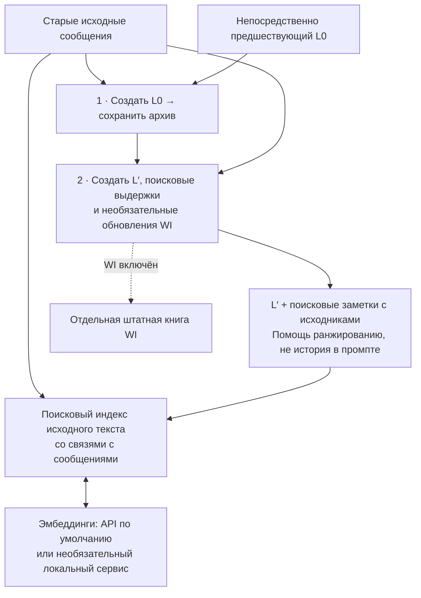
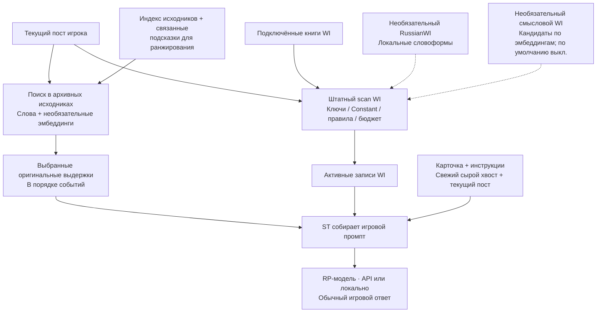

# WorldMemory для SillyTavern

[English](README.md) · [Подробная инструкция](docs/REFERENCE_RU.md) · [Изменения](CHANGELOG.md)

> **Аддон не cache-friendly:** WorldMemory каждый ход пересобирает восстановленную историю, отправляемую на инференс. Это может снижать переиспользование кэша промпта/входных токенов у API-провайдера; неизменные части запроса при этом могут по-прежнему кэшироваться.

**Возвращайте нужные события прошлой истории по мере роста чата.** WorldMemory сохраняет резюме старых сообщений со связями с исходниками, подбирает нужную историю для следующего ответа и ведёт отдельную справочную книгу World Info о персонажах и других сущностях.

**0.3.3 · самостоятельная preview-версия.** Устанавливать Summaryception не нужно. По умолчанию используются API-эмбеддинги; локальная модель необязательна.

**Что устанавливать:** [WorldMemory](https://github.com/Ilya626/Extension-WorldMemory) и, для русских словоформ ключей WI, [Russian WI Forms](https://github.com/Ilya626/Extension-RussianWI). Словарь уже включён во второй аддон. Summaryception, MemoryBooks, MarkUps, Tavern Helper и ST Vector Storage для работы WorldMemory не требуются. [Короткая инструкция: установка, обновление и импорт готового чата](docs/INSTALL_AND_PLAY_RU.md).

## Что получает модель

Для обычного игрового ответа SillyTavern собирает карточку и инструкции, свежие сообщения, выбранную раннюю историю и активный World Info. **WorldMemory не вставляет весь архив в каждый ответ.**

| Часть контекста | Для чего нужна | По умолчанию |
| --- | --- | --- |
| **Raw tail (tokens)** | Сохранить последние сообщения в исходном виде | 8 000 токенов |
| **Max history tokens (soft target)** | Вернуть нужные ранние выдержки в порядке событий; ручные правки и резюме без исходников подписываются | 8 000 токенов, мягкий ориентир |
| **World Info · entity reference** | Подать справочные записи через штатную активацию и бюджет ST | Отдельная книга текущего чата |
| **Full RP prompt target (tokens)** | Показать ориентир размера всего входа, включая карточку, инструкции и WI | 24 000 токенов, мягкий ориентир |

У сырого хвоста и восстановленной истории разные лимиты. Целые фрагменты истории могут превысить свой ориентир; целевой размер полного промпта не является жёстким пределом запроса ST. Размер сохранённого архива эти настройки не ограничивают.

**История отвечает «что произошло?», WI — «кто или что это?»** История может восстановить разговор, в котором хозяин мастерской дал посетителю ключ до утра. Его WI-запись описывает самого человека, мастерскую и значимые связи. Это повторно используемая справка, а не второй дневник всех сцен.

## Два пути: сохранение памяти и игровой ответ

**Когда готов пакет старых сообщений** — два последовательных запроса суммаризатору, а не два запроса на каждом игровом ходу:



Архив, связи с исходниками, индекс и WI хранятся/обслуживаются в вашей установке ST. Запросы 1–2 идут через подключение суммаризатора: удалённый API или локальную модель. Эмбеддинги отправляют индексируемый текст и запросы выбранному API или локальному сервису; новые векторы нужны только для новых/изменённых входов, сохранённые переиспользуются. Подготовку можно запускать и вручную.

**Для каждого обычного RP-ответа** — локальный поиск истории и штатная активация WI готовят обычный запрос ST:



Состав промпта: **карточка/инструкции + выбранные выдержки истории + сырой хвост + активный WI + текущий пост**; расположение определяется настройками ST/WorldMemory. L′ помогает ранжировать исходники, но не вставляется автоматически как хронология; весь архив тоже не отправляется. Ручные правки и резюме без исходников могут попадать в контекст как явно подписанная память. Ранжирование и проверка границ исходных выдержек локальные; дополнительный LLM-проверяющий поиску не нужен. При включённом смысловом поиске запрос эмбеддингов может обращаться к выбранному сервису каждый ход (сохранённые входы переиспользуются). Штатные ключи/Constant и словоформы RussianWI работают локально; смысловой WI только добавляет кандидатов в тот же штатный scan.

## Установка и подключение

1. В SillyTavern откройте **Extensions → Install extension** и вставьте:

   ```text
   https://github.com/Ilya626/Extension-WorldMemory
   ```

   Установите расширение, перезагрузите страницу, откройте чат персонажа и **Extensions → WorldMemory**.
2. В **Summarizer connection → Connection** выберите подключение фоновой генерации: **Current SillyTavern connection**, **SillyTavern Connection Profile**, **OpenAI-compatible API** или **Ollama**. Заполните показанные поля. Укажите **L0 language**; `0` в **Response token override** наследует настройку подключения.
3. В **Search and embeddings** настройте embedding API. На новой установке включён **Search history by meaning (embeddings)** и выбран **Embedding connection → API embeddings**:

   | Поле | Начальное значение |
   | --- | --- |
   | **API URL** | Базовый адрес embedding API провайдера; для штатного Google API — `https://generativelanguage.googleapis.com` |
   | **API key** | Ключ этого API |
   | **API format** | **Google / Gemini embeddings** |
   | **Embedding model** | `gemini-embedding-001` |
   | **Advanced embedding API settings → Dimensions** | `768` |

   Для OpenAI-совместимого endpoint выберите **OpenAI-compatible embeddings**, поддерживаемую embedding-модель и её размерность. Название чат-модели не подходит вместо embedding-модели.

   **Пустые URL/key наследуются только из собственного подключения WorldMemory «OpenAI-compatible API».** Штатное подключение ST и Connection Profile не раскрывают здесь сохранённые ключи; укажите embedding URL/key явно. Настройки ST Vector Storage не используются.
4. Оставьте **Enable WorldMemory** включённым. В **World Info · entity reference** оставьте **Prepare and apply WI after saving L0**, если нужны генерируемые справки. **Also find WI by meaning** — отдельная опция, по умолчанию выключенная.
5. Продолжайте чат. Когда пакет старых подходящих сообщений готов, суммаризация запускается автоматически; **Summarize** запускает её вручную. Память можно проверить в **L0 archive**, справки — через **Open lorebook**.

Для API-эмбеддингов не нужны локальные веса и компилятор. Без эмбеддингов остаётся поиск истории по словам. Необязательный [Russian WI Forms](https://github.com/Ilya626/Extension-RussianWI) добавляет словоформы к штатным ключам WI: например, `меч` → `мечом`.

## Как растёт память

**L0** — сохранённое повествовательное резюме одного пакета исходных сообщений. WorldMemory накапливает такие пакеты в архиве, без переноса между слоями и постоянного сжатия всей истории в одно резюме.

Для нового пакета выполняются **два последовательных фоновых запроса генерации** через подключение суммаризатора:

1. **Написать и сохранить L0.** Модель получает оригиналы пакета и **полный непосредственно предшествующий L0** для связности повествования. Новый L0 сохраняется до следующего шага.
2. **Подготовить поисковые заметки и необязательный WI.** Модель получает сохранённый L0 и те же оригиналы: создаёт короткую навигационную нить L′, связанные с исходниками поисковые выдержки и обновления справок о сущностях. Прежние резюме и WI помогают узнать сущность; доказательства новых утверждений берутся из оригиналов этого пакета.

Это отдельные запросы, помимо обычного игрового ответа. Embedding-запросы также отправляют индексируемый текст и поисковые запросы настроенному embedding service. Изменённые исходники индексируются по необходимости, неизменные векторы переиспользуются. В фоновую генерацию может входить штатный WI как справка только для чтения; это регулируется в **Advanced summarizer context**.

По умолчанию пакет исходников — 24 000 токенов. Сырой хвост и **BlindZone (recent exchanges)** защищают свежие сообщения; BlindZone по умолчанию равен одному обмену репликами. Эти настройки и **Pause automatic summarization** находятся в **Advanced history and packet settings**. Оригиналы остаются в чате; настройки скрытия определяют, какие суммаризированные сообщения отправляются модели. Повторное автоматическое скрытие по умолчанию выключено, чтобы сохранять ручной выбор видимости.

## Просмотр, правки и восстановление

- **Изменить L0:** раскройте пакет и нажмите **Save text**. **Regenerate** переписывает его по связанным исходникам; **Refine** дополнительно получает существующий текст. **Advanced summary prompts** показывает сохранённые/пользовательские системные инструкции и шаблон L0; меняет только его прозу, а не отдельные инструкции поисковых заметок/WI.
- **Если подготовка поиска/WI не удалась:** L0 уже сохранён. **Rebuild search notes / WI** повторяет второй запрос для одного пакета, **Prepare missing search notes / WI** — для незавершённых пакетов, без переписывания L0. **Apply saved WI** применяет сохранённый результат локально, без запроса к модели.
- **Защитить правку WI:** используйте **Keep manual**; **Allow automatic updates** возвращает автоматическое обслуживание. Авторские книги и привязки сохраняются. Созданные записи подчиняются штатным ключам, Constant, группам и бюджету ST; семантика WI добавляет кандидатов в тот же scan.
- **Если исходники изменены:** L0 помечается **SOURCES CHANGED**, устаревшие поисковые свидетельства исключаются. Обновите этот пакет через **Regenerate**. Ручные правки WI и выбор видимости сохраняются.

[Подробные настройки, вставка, поиск и копии](docs/REFERENCE_RU.md) · [Необязательная локальная EmbeddingGemma 2 Q8: Windows и Termux preview](docs/LOCAL_EMBEDDINGS_RU.md)

## Обновление и перенос

Сделайте **WorldMemory → Portable backup → Export backup** и отдельно экспортируйте чат ST с оригиналами и свайпами. Обновите **World Memory** через менеджер расширений ST и перезагрузите страницу. **Сохранённые настройки пользователя остаются**; обновление не включает семантический поиск, если вы ранее его отключили.

Ранее выключенная история переносится в **Advanced history insertion → Insert retrieved history → Off — do not send history**. Чтобы включить её, выберите там место вставки, например **Immediately before chat history**.

При наличии Summaryception WorldMemory импортирует сохранённый архив и соответствующие настройки. Если старое расширение активно, WorldMemory сохраняет импорт, отключает старый runtime и один раз перезагружает страницу. Перед продолжением проверьте **L0 archive**; не включайте оба архивных writer в одном чате. Импортированные резюме без доступных оригиналов остаются summary-only.

**Import backup заменяет состояние WorldMemory принимающего чата.** Сначала экспортируйте его текущее состояние. Одна книга WI не восстанавливает историю: сохраняйте и backup WorldMemory, и исходный чат.

## Ограничения preview

### На чём проверяли

WorldMemory тестировали и настраивали преимущественно с Sol 6.1 (`gpt-6.1-sol`) для фоновой генерации L0, поисковой разметки и подготовки World Info. В тестовых архивах также есть импортированные резюме Gemini/Anthropic и ранее написанная предыстория: Sol не пересоздавал их все заново. Эти опыты не доказывают одинаковое качество с любым суммаризатором или игровой моделью.

Проверяйте важную память и справки: генерация может пропустить деталь, перепутать сущность или условие; подбор истории зависит от запроса, исходников и моделей. Preview не обещает полного воспроизведения всех деталей. Локальные эмбеддинги необязательны; Termux-Gemma скрипты остаются preview, проверка на настоящем телефоне отложена.

Лицензия: [AGPL-3.0](LICENSE) · [Уведомления о стороннем коде](THIRD_PARTY_NOTICES.md). Включённые модули Summaryception сохраняют свою [vendor-лицензию](vendor/summaryception/LICENSE).
